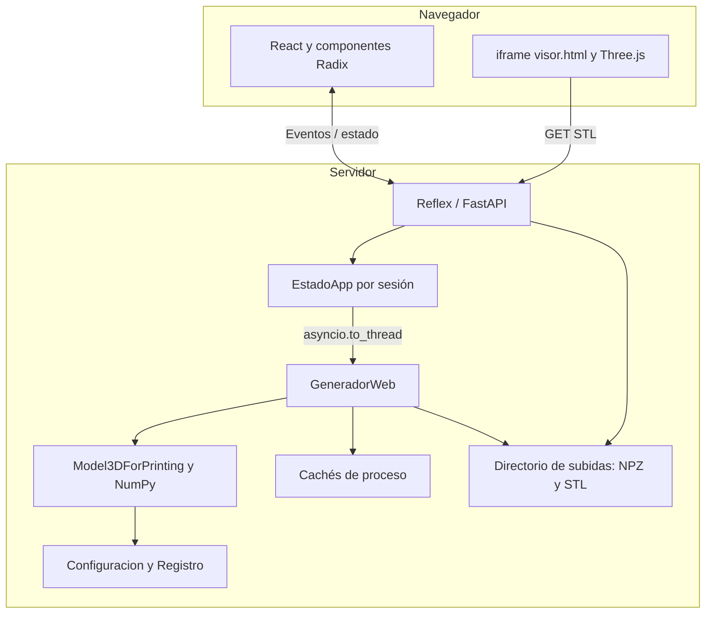
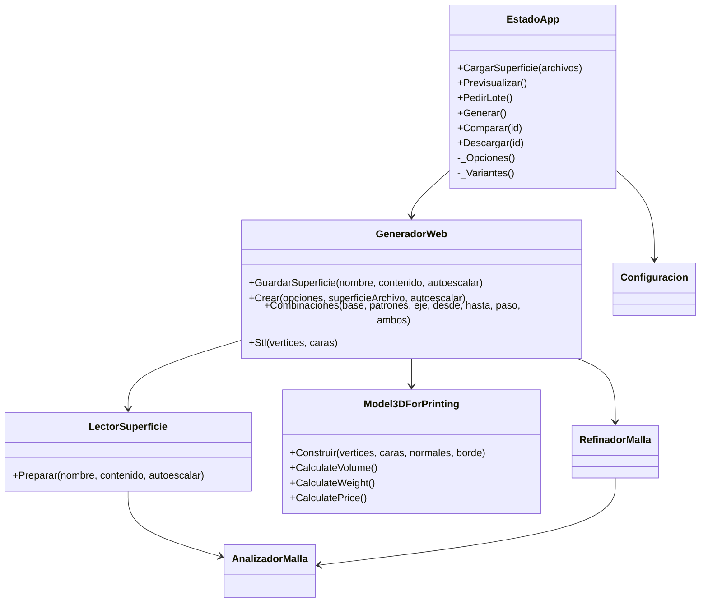
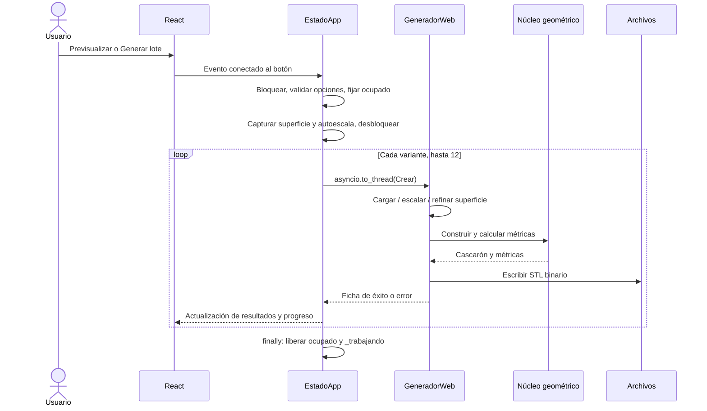

# Arquitectura interna de AppBackend

## Contexto y límites

El servidor coordina entradas de superficie, parámetros de diseño y variantes. `EstadoApp` gestiona la interacción; `GeneradorWeb` prepara y escribe resultados; `Model3DForPrinting` calcula geometría y métricas. No hay base de datos de dominio, cuentas de usuario, API REST de generación propia, cola distribuida ni ejecución de Blender.

Reflex compila componentes Python a React y ejecuta los manejadores de estado en un servidor FastAPI. Los eventos y cambios de estado viajan mediante la conexión WebSocket gestionada por el framework; las subidas y la entrega de archivos usan su soporte HTTP. Esta aplicación declara los componentes y handlers, sin implementar manualmente ese protocolo. Referencia: [arquitectura oficial de Reflex](https://reflex.dev/docs/advanced-onboarding/how-reflex-works/).

## Arranque y despliegue local

[`rxconfig.py`](../../rxconfig.py) declara `app_name="GenerateModelsApp"` pero carga `app_module_import="web.GenerateModelsApp"`. Esto evita interpretar el paquete Blender como la aplicación web. [`web/GenerateModelsApp.py`](../../web/GenerateModelsApp.py) crea `rx.App` y registra `PaginaComparacion.Index`, título `OrtesisLab`, con `EstadoApp.CargarPredeterminados` en `on_load`.

Los puertos predeterminados de desarrollo son 3000 para el frontend y 8000 para el backend. Son valores del framework, no puertos fijados por el código del proyecto. `.web/` contiene la compilación React/Vite/React Router; `.states/` contiene artefactos locales de estado; no son carpetas de lógica de negocio. El proyecto no configura Redis ni un gestor persistente propio.

## Colaboración de clases UML

## Generación y concurrencia

`Previsualizar` establece `modo_lote=False`; `PedirLote`, `True`. Ambos devuelven el evento `Generar`. Este es un `@rx.event(background=True)`: obtiene el bloqueo mediante `async with self`, impide duplicados con `_trabajando`, toma una instantánea de variantes, archivo y autoescala, y libera el bloqueo antes del cálculo. Cada variante se calcula en `asyncio.to_thread`; el lote es **secuencial**, no un pool de variantes paralelas. Tras cada resultado vuelve a bloquear brevemente para publicar el progreso. Referencia del mecanismo: [eventos de fondo de Reflex](https://reflex.dev/docs/events/background-events/).

Un error previsto produce una ficha con `archivo=""`; los errores inesperados se registran con traza y se muestran como `fallo`. La primera variante válida se abre automáticamente. Si falla la preparación, no empieza el lote. `finally` restablece la disponibilidad, pero no equivale a una transacción de disco ni permite reanudar trabajos tras reinicio.

## Persistencia y límites operativos

Las fichas viven en el estado de sesión. Los STL y NPZ viven en `rx.get_upload_dir()`, normalmente `uploaded_files/`. No hay política de borrado, catálogo duradero, TTL, auditoría ni permisos de propiedad de archivos implementados por la aplicación. Un UUID dificulta colisiones y descubrimiento casual; no es autorización. Los NPZ internos están en el mismo directorio de subidas, por lo que el comentario «copia privada» no debe interpretarse como control de acceso.

Las cachés de `GeneradorWeb` son variables de clase compartidas por el proceso: máximo dos superficies crudas y dos refinadas, con expulsión por orden de inserción. No son cachés por sesión, no tienen bloqueo explícito y no se comparten entre procesos. El guard `_trabajando` protege una sesión, no toda la aplicación. Reiniciar limpia RAM pero no los archivos escritos. Si se cambian límites/configuración en caliente, se debe reiniciar para evitar refinados web calculados con la configuración anterior.

## Decisiones observadas y deuda

| Decisión actual | Consecuencia |
|---|---|
| Núcleo Python sin Blender | Se comparte geometría sin lanzar un proceso 3D |
| Arrays y archivos fuera del estado reactivo | El navegador recibe fichas y URLs; la geometría no viaja como vars |
| Máximo 12 variantes / 3 vistas | Contiene el trabajo por petición y el número de contextos WebGL |
| Macizo web sin refinamiento; Blender siempre refina | Puede haber diferencias en curvas y contornos; no prometer igualdad byte a byte |
| Voxel y validación final exclusivos de Blender | Descargar un STL web no implica superar `ValidadorMalla` |
| Archivos locales y cachés de proceso | Un despliegue multiproceso/multihost necesita almacenamiento y coordinación adicionales |

Autenticación, cuotas globales, limpieza de subidas y almacenamiento compartido son mejoras pendientes; no forman parte de la infraestructura desarrollada.
