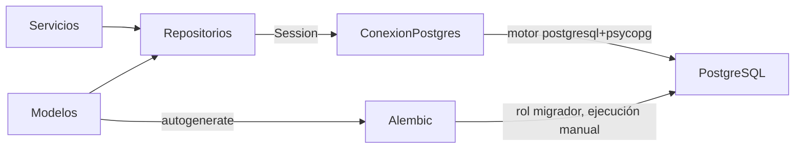
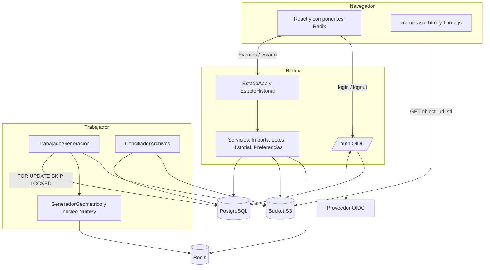
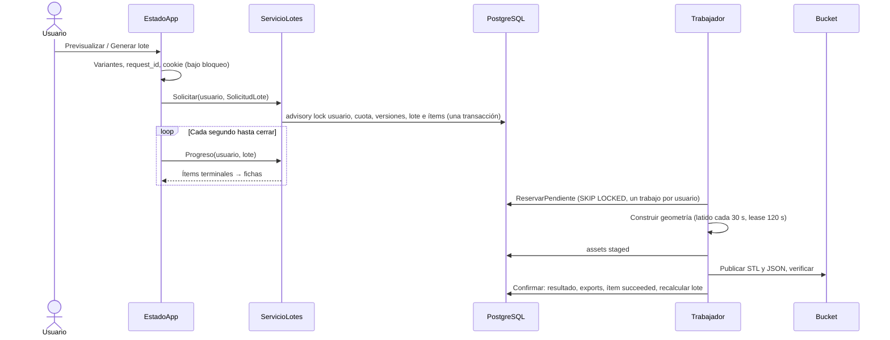

# Arquitectura interna de AppBackend

## Contexto y límites

El servidor coordina cuentas, superficies, parámetros, versiones y lotes de generación. Hay cuatro procesos o servicios:

| Pieza | Responsabilidad |
|---|---|
| Reflex (`web.GenerateModelsApp`) | Páginas, eventos de estado, rutas OIDC `/auth/*`, admisión de lotes y lectura del progreso |
| Trabajador (`scripts/EjecutarTrabajador.py`) | Reserva ítems de la cola en PostgreSQL, construye la geometría con el núcleo NumPy, publica STL/JSON y concilia archivos |
| PostgreSQL 17 | Fuente de verdad: usuarios, sesiones, preferencias, proyectos, imports, versiones, lotes, intentos, resultados, exports e historial |
| Bucket S3 (MinIO) | Bytes de originales subidos, NPZ normalizados, STL y JSON de resultados; PostgreSQL guarda clave, `object_url`, tamaño y SHA-256 |
| Redis | Caché por contenido de superficies crudas/refinadas y su diagnóstico de escala; si no responde, todo sigue funcionando sin caché |

Reflex compila componentes Python a React y ejecuta los manejadores en su servidor ASGI. Los eventos viajan por la conexión WebSocket del framework. Referencia: [arquitectura oficial de Reflex](https://reflex.dev/docs/advanced-onboarding/how-reflex-works/). La persistencia usa SQLAlchemy 2.0 sobre psycopg 3. Los modelos de [`Modelos.py`](../../web/persistence/Modelos.py) describen el esquema y alimentan Alembic. Las consultas son sentencias SQLAlchemy dentro de los repositorios, que reciben una `Session` y devuelven DTO. No hay ejecución de Blender en ninguna pieza.

## Arranque

[`rxconfig.py`](../../rxconfig.py) carga `app_module_import="web.GenerateModelsApp"`. [`web/GenerateModelsApp.py`](../../web/GenerateModelsApp.py):

- crea `rx.App(api_transformer=AutenticacionOidc.Aplicacion())`, que monta `/auth/login`, `/auth/callback` y `/auth/logout` junto a la aplicación Reflex;
- registra la tarea de ciclo de vida `PoolPostgres`, que abre el motor SQLAlchemy con `ORTESISLAB_DATABASE_URL` (rol `ortesislab_app`, una conexión de prueba al arrancar y hasta 4 en el pool) y lo cierra al parar; si la base no responde al arrancar, lo registra y los handlers devuelven el mensaje de persistencia no disponible;
- registra `/` (`PaginaComparacion.Index`, `on_load=EstadoApp.CargarPredeterminados`) y `/historial` (`PaginaHistorial.Index`, `on_load=EstadoHistorial.Cargar`).

El trabajador es un proceso aparte con el rol `ortesislab_worker` (máximo 2 conexiones). Ambos, igual que Alembic y las pruebas, leen la configuración solo a través de la clase `Ajustes` de [`web/Ajustes.py`](../../web/Ajustes.py): variables `ORTESISLAB_*` del entorno o del `.env` raíz (ver [`.env.example`](../../.env.example)). Una variable obligatoria ausente lanza `VariableFaltante` al leerse; no hay modos degradados por configuración incompleta, salvo Redis, cuya URL vacía desactiva la caché. Los límites, tiempos y tamaños que cita este documento (lease, latido, cuotas, TTL, plazos de conciliación, duración de sesión) son los valores actuales de [`config/*.yaml`](OPERACION_Y_PRUEBAS.md#valores-ajustables-configyaml), que lee `ConfiguracionBackend`.

## Identidad y propiedad

`/auth/callback` recibe la identidad OIDC (`iss`, `sub`), hace upsert en `app_users`, crea una fila en `auth_sessions` con el SHA-256 de un token aleatorio y fija la cookie `ortesislab_sesion` (HttpOnly, SameSite=Lax, 12 horas, `Secure` si `ORTESISLAB_COOKIE_SECURE`). Cada handler resuelve el usuario desde `self.router.headers.cookie` con `ContextoUsuario.Requerir`; el navegador nunca envía un `user_id`. Las sesiones revocadas, vencidas o de cuentas desactivadas se rechazan.

Toda consulta filtra por `user_id` y las claves foráneas compuestas `(id, user_id)` impiden que una fila referencie recursos de otro usuario. Un recurso ajeno responde igual que uno inexistente (`AccesoDenegado`). `ContextoUsuario.Activar` fija el usuario en una `contextvar` para las funciones heredadas de `GeneradorWeb` que no reciben usuario en su firma.

## Generación como cola durable

- **Admisión** (`ServicioLotes.Solicitar`): bloqueo consultivo por usuario, idempotencia por `request_id` (mismo cuerpo → mismo lote; cuerpo distinto → `SolicitudIdempotenteEnConflicto`), máximo 3 lotes pendientes y 12 ítems. Crea las versiones (`model_versions`, numeradas por proyecto), el lote y sus ítems en la misma transacción. El modo `retry` reutiliza versiones existentes.
- **Ejecución**: el trabajador reserva un ítem `queued` sin otro ítem `running` del mismo usuario, crea un intento con `lease_token` y renueva el lease desde un hilo de latido. Antes de confirmar comprueba que su lease sigue vigente; un intento vencido no sobrescribe al ganador.
- **Fallos**: un fallo previsto o inesperado se registra en el intento; con intentos restantes el ítem vuelve a la cola con espera 5 s · 2^(n−1); al agotar 3 intentos queda `failed`. La cancelación se pide en el lote y el trabajador la observa entre etapas.
- **Cierre**: `Recalcular` cierra el lote como `succeeded`, `partial`, `failed` o `cancelled` y emite `batch_finished`.
- **Recuperación**: el lote vive en la base; tras recargar la página o reiniciar Reflex, `CargarPredeterminados` busca el último lote del usuario (`ServicioLotes.Ultimo`) y reanuda el seguimiento si sigue abierto.

`GeneradorWeb.Crear` conserva su firma: encola un lote `single`, espera hasta 600 s al trabajador y devuelve la ficha persistida.

## Archivos y caché

Clave de objeto: `usuarios/<user_id>/assets/<asset_id>`; los STL de resultado llevan además el sufijo `.stl`. El flujo de dos recursos es: fila `staged` → subir y verificar objeto (tamaño y SHA-256) → fila `ready` con `object_url`. Si falla la subida, la fila staged queda para el conciliador.

La política del bucket concede lectura anónima solo a `usuarios/*/assets/*.stl`; originales, NPZ y JSON exigen credenciales del backend. El visor y la descarga usan la `object_url` del STL directamente. La URL contiene dos UUID aleatorios, pero quien la conozca puede leer ese STL: es una decisión de esta entrega.

`CacheRedis` guarda tuplas de superficie con clave por SHA-256 del NPZ (contenido, no nombre), paso y autoescala, con TTL de 7 días. Un fallo de Redis apaga la caché 30 s y la generación lee del bucket.

`ConciliadorArchivos` corre en el trabajador cada 600 s: borra staged de más de 24 h, imports rechazados de más de 30 días, marca `missing` las filas ready sin objeto (y sus exports) y borra objetos huérfanos de más de 24 h.

## Decisiones y límites

| Decisión | Consecuencia |
|---|---|
| Núcleo Python sin Blender en el trabajador | Se comparte geometría sin abrir Blender; voxel y validación final siguen exclusivos del complemento |
| Cola en PostgreSQL con `SKIP LOCKED` | No se necesita otro broker; la concurrencia está acotada a un trabajo por usuario y uno por proceso trabajador |
| Lectura anónima de STL por URL | El visor carga sin proxy; la URL no es un secreto fuerte |
| Redis como caché pura | Perderlo solo cuesta tiempo de cálculo |
| Máximo 12 variantes / 3 vistas / 3 lotes pendientes | Contiene trabajo por petición, contextos WebGL y uso de la cola |
| SQLAlchemy con repositorios y DTO | Las firmas de repositorios y servicios no exponen modelos ORM; el estado Reflex nunca guarda una `Session` |
| Alembic sin revisiones versionadas en el repositorio y sin bloqueo | Las migraciones las genera y aplica a mano el responsable del esquema desde un único operador; `GRANT`, trigger de versiones y FK circular se añaden a mano a la revisión |
