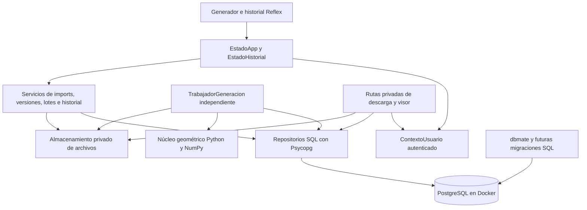
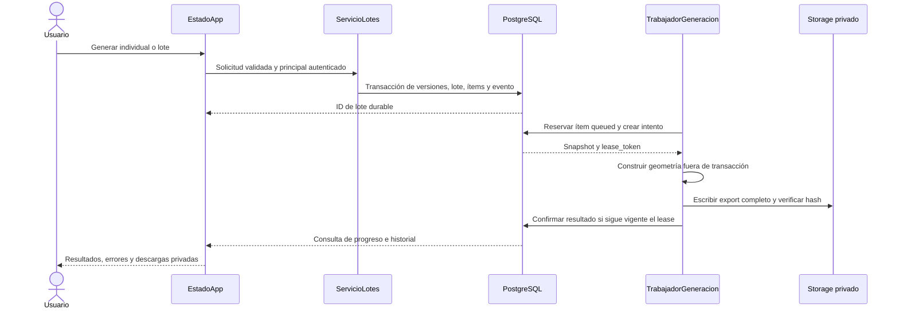
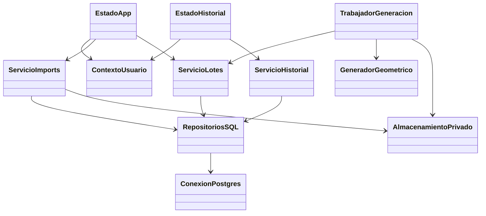

# DATABASE — Propuesta de PostgreSQL, versiones e historial

**Estado:** propuesta de implementación; no implementada. **Fecha:** 2026-10-13. **Ámbito:** backend Reflex, persistencia y futura vista de historial.

**Decisiones del usuario:** PostgreSQL sin ORM; archivos STL/NPZ en almacenamiento privado y metadatos en PostgreSQL; conservar imports, preferencias, parámetros, versiones, lotes y exports. Este documento especifica Docker, Makefile y migraciones como trabajo futuro. No crea base, contenedores, migraciones, seeds, clases ni Makefile.

## 1. Objetivo y alcance

Permitir que una persona autenticada retome su trabajo, consulte versiones anteriores de una ortesis y conozca qué superficie, parámetros y versión del generador produjeron cada resultado. Cada generación individual o por lote debe dejar un historial durable de éxitos, errores y reintentos. Una pantalla aparte permitirá buscar, comparar, descargar y volver a generar desde una versión anterior sin sobrescribirla.

Se propone PostgreSQL 17 para el servicio relacional, Psycopg 3 para SQL parametrizado desde Python y dbmate para migraciones SQL. No se usarán Drizzle, Prisma, SQLModel, SQLAlchemy ni `rx.Model` como capa de persistencia. Las clases propuestas son servicios, repositorios SQL y DTO; no entidades ORM.

### Situación actual contrastada con el código

| Área | Actualmente | Propuesta |
|---|---|---|
| Identidad | No hay autenticación ni usuarios persistentes implementados | Principal autenticado resuelto en backend y usuario estable |
| Imports | `GuardarSuperficie` escribe NPZ normalizado bajo `rx.get_upload_dir()` | Conservar original y normalizado como assets privados, con hash y propietario |
| Preferencias | Estado Reflex y defaults JSON; sin historial durable | Preferencias por usuario y snapshots inmutables por versión |
| Generación | `EstadoApp.Generar` coordina un background event y calcula variantes secuenciales | Registrar solicitud y trabajos durables; trabajador independiente los ejecuta |
| Resultados | Fichas de cadenas y STL; se pierden las fichas de sesión al reiniciar | Resultados numéricos, archivos privados y eventos persistidos |
| Lotes | `GeneradorWeb.Combinaciones` admite hasta 12 variantes | Mantener inicialmente ese límite y registrar cada variante e intento |
| Historial | No existe vista ni consultas de historial | Ruta `/historial` con filtros, detalle y paginación |

Fuentes actuales: [EstadoApp.py](../../web/EstadoApp.py), [GeneradorWeb.py](../../web/GeneradorWeb.py), [LectorSuperficie.py](../../web/LectorSuperficie.py), [entrada Reflex](../../web/GenerateModelsApp.py) y [contratos existentes](CONTRATOS.md). La web continúa usando el núcleo Python/NumPy sin ejecutar Blender. Registrar un resultado no equivale a validarlo con Blender.

### Fuera de alcance de esta propuesta

Colaboración entre usuarios, permisos de equipo, historial de modificaciones dentro de Blender, simulación mecánica y billing. El proveedor concreto de identidad queda por seleccionar, detrás de un contrato de autenticación. La incorporación de PostgreSQL no corrige por sí misma los problemas abiertos de la [auditoría del código](../Audit/README.md).

## 2. Arquitectura propuesta

PostgreSQL conserva relaciones, parámetros, métricas y estados. El almacenamiento privado conserva bytes. Reflex solo conserva filtros, IDs y DTO de presentación. Las conexiones y cursores no se guardan dentro de `rx.State`.

Se propone un pool **síncrono** de Psycopg por proceso y llamadas de servicios mediante `asyncio.to_thread` desde handlers asíncronos de Reflex. Esto evita bloquear el event loop y encaja con el uso actual de `to_thread`. Se prefiere esta variante para el entorno Windows del proyecto: Psycopg documenta incompatibilidad de su API asíncrona con el loop Proactor predeterminado. No cambiar globalmente el loop de Reflex sin una revisión específica. [Psycopg: concurrencia y Windows](https://www.psycopg.org/psycopg3/docs/advanced/async.html).

Las conexiones se abren al iniciar el backend/trabajador y se cierran al terminar. Cada servicio toma una conexión del pool durante una transacción corta; nunca mantiene una transacción abierta mientras genera geometría, valida un archivo grande o transmite un STL. Dimensionamiento inicial propuesto: mínimo 1, máximo 4 conexiones por backend y máximo 2 por trabajador; revisar el total de procesos frente a `max_connections`. [Psycopg: pools](https://www.psycopg.org/psycopg3/docs/advanced/pool.html).

## 3. Identidad, propiedad y unidades

1. El identificador estable del usuario procede de una sesión autenticada validada por servidor. El token de sesión de Reflex no constituye identidad autenticada.
2. `auth_issuer + auth_subject` identifica la cuenta del proveedor. El email es dato de contacto, no clave primaria.
3. Cada repositorio recibe `user_id` desde `ContextoUsuario`, nunca desde un campo editable del navegador. Todas las consultas de recursos incluyen propietario.
4. Las tablas de dominio usan UUID generados en Python, fechas `timestamptz` en UTC y nombres SQL `snake_case`.
5. Volumen en mm³, peso en gramos y dimensiones en mm se almacenan como números. El frontend agrega unidades y formato español al mostrar.
6. Cada resultado conserva densidad, precio por gramo y moneda nullable tal como se emplearon. No asignar retrospectivamente una moneda al PETG actual, que no la declara.
7. Parámetros se almacenan como JSONB tipado por un DTO validado. Las referencias, propietarios y estados siguen siendo columnas relacionales; no convertir toda la base en un único JSON.

Autenticación es una dependencia de implementación: no activar historial privado hasta contar con verificación de sesión, expiración y resolución de principal. Se propone un adaptador OIDC con sesiones de servidor; proveedor y configuración de despliegue se seleccionan antes de habilitarlo. El seed de desarrollo no debe habilitar acceso real ni omitir autenticación.

## 4. Modelo entidad-relación

El modelo distingue una **versión de diseño** de sus **intentos de ejecución**. Reintentar una versión crea otro intento; editar sus parámetros crea otra versión.

```mermaid
erDiagram
  APP_USERS {
    uuid id PK
    text auth_issuer UK "Parte de UK1: issuer y subject"
    text auth_subject UK "Parte de UK1: issuer y subject"
    text email "nullable"
    text display_name
    text status
    timestamptz created_at
    timestamptz updated_at
  }
  USER_PREFERENCES {
    uuid user_id PK, FK
    boolean auto_scale
    text locale
    text display_currency "nullable"
    jsonb default_parameters
    bigint revision
    timestamptz created_at
    timestamptz updated_at
  }
  FILE_ASSETS {
    uuid id PK
    uuid user_id FK
    text storage_key UK
    text kind
    text original_name "nullable"
    text media_type
    bigint size_bytes
    char sha256 "char(64)"
    text status
    timestamptz created_at
    timestamptz ready_at "nullable"
    timestamptz deleted_at "nullable"
  }
  PROJECTS {
    uuid id PK
    uuid user_id FK
    text name
    text description "nullable"
    bigint next_version_number
    timestamptz created_at
    timestamptz updated_at
    timestamptz archived_at "nullable"
  }
  IMPORTS {
    uuid id PK
    uuid user_id FK
    uuid project_id FK
    uuid original_asset_id FK
    uuid normalized_asset_id FK "nullable"
    text source_kind
    text status
    text format
    bigint vertex_count "nullable"
    bigint face_count "nullable"
    jsonb raw_dimensions_mm "nullable"
    text reader_version
    integer normalization_schema_version
    text error_code "nullable"
    text error_message "nullable"
    timestamptz created_at
    timestamptz finished_at "nullable"
  }
  MODEL_VERSIONS {
    uuid id PK
    uuid user_id FK
    uuid project_id FK, UK "Parte de UK1: proyecto y numero"
    uuid import_id FK
    uuid parent_version_id FK "nullable"
    bigint version_number UK "Parte de UK1: proyecto y numero"
    text label "nullable"
    text change_note "nullable"
    jsonb parameters
    integer parameter_schema_version
    boolean auto_scale
    jsonb material_snapshot
    text requested_backend
    char parameters_sha256 "char(64)"
    timestamptz created_at
  }
  GENERATION_BATCHES {
    uuid id PK
    uuid user_id FK, UK "Parte de UK1: usuario y request"
    uuid project_id FK
    uuid request_id UK "Parte de UK1: usuario y request"
    char request_sha256 "char(64)"
    text mode
    jsonb definition
    text status
    integer total_items
    timestamptz cancel_requested_at "nullable"
    timestamptz created_at
    timestamptz started_at "nullable"
    timestamptz finished_at "nullable"
  }
  BATCH_ITEMS {
    uuid id PK
    uuid user_id FK
    uuid project_id FK
    uuid batch_id FK, UK "Parte de UK1: lote y posicion"
    uuid version_id FK
    integer position UK "Parte de UK1: lote y posicion"
    text status
    integer attempt_count
    integer max_attempts
    timestamptz available_at
    uuid lease_token "nullable"
    timestamptz lease_expires_at "nullable"
    uuid winning_attempt_id FK "nullable; intento de este item"
    timestamptz created_at
    timestamptz updated_at
  }
  GENERATION_ATTEMPTS {
    uuid id PK
    uuid user_id FK
    uuid batch_item_id FK, UK "Parte de UK1: item y numero"
    integer attempt_number UK "Parte de UK1: item y numero"
    text worker_id
    uuid lease_token
    text status
    text generator_version
    text code_revision
    jsonb runtime_snapshot
    float8 effective_scale "nullable; double precision"
    float8 effective_step_mm "nullable; double precision"
    jsonb execution_parameters
    text error_code "nullable"
    text error_message "nullable"
    boolean retryable
    timestamptz created_at
    timestamptz started_at
    timestamptz heartbeat_at
    timestamptz finished_at "nullable"
    bigint duration_ms "nullable"
  }
  GENERATION_RESULTS {
    uuid id PK
    uuid user_id FK, UK "Parte de UK1: usuario e intento"
    uuid batch_item_id FK
    uuid attempt_id FK, UK "Parte de UK1: usuario e intento"
    float8 volume_mm3 "double precision"
    float8 weight_g "double precision"
    numeric estimated_price
    numeric price_per_gram
    numeric density_g_cm3
    text currency "nullable"
    bigint vertices
    bigint triangles
    jsonb dimensions_mm
    text validation_status
    jsonb validation_report
    jsonb warnings
    text geometry_scope
    timestamptz created_at
  }
  EXPORTS {
    uuid id PK
    uuid user_id FK, UK "Parte de UK1: usuario resultado formato"
    uuid result_id FK, UK "Parte de UK1: usuario resultado formato"
    uuid asset_id FK
    text format UK "Parte de UK1: usuario resultado formato"
    text units
    text exporter_version
    text status
    timestamptz created_at
  }
  HISTORY_EVENTS {
    bigint id PK "GENERATED ALWAYS AS IDENTITY"
    uuid user_id FK
    uuid project_id FK
    uuid version_id FK "nullable"
    uuid batch_id FK "nullable"
    uuid attempt_id FK "nullable"
    uuid export_id FK "nullable"
    text event_type
    jsonb payload
    timestamptz created_at
  }

  APP_USERS ||--o| USER_PREFERENCES : configura
  APP_USERS ||--o{ PROJECTS : posee
  APP_USERS ||--o{ FILE_ASSETS : posee
  PROJECTS ||--o{ IMPORTS : recibe
  FILE_ASSETS ||--o{ IMPORTS : original_o_normalizado
  PROJECTS ||--o{ MODEL_VERSIONS : agrupa
  IMPORTS ||--o{ MODEL_VERSIONS : superficie_base
  MODEL_VERSIONS o|--o{ MODEL_VERSIONS : deriva_de
  PROJECTS ||--o{ GENERATION_BATCHES : solicita
  GENERATION_BATCHES ||--|{ BATCH_ITEMS : contiene
  MODEL_VERSIONS ||--o{ BATCH_ITEMS : ejecuta
  BATCH_ITEMS ||--o{ GENERATION_ATTEMPTS : reintenta
  GENERATION_ATTEMPTS ||--o| GENERATION_RESULTS : produce
  GENERATION_RESULTS ||--o{ EXPORTS : publica
  FILE_ASSETS ||--o{ EXPORTS : contenido
  PROJECTS ||--o{ HISTORY_EVENTS : registra
  APP_USERS ||--o{ HISTORY_EVENTS : actor
```

El diagrama incluye los atributos de las doce entidades. `PK` identifica la clave primaria; `FK`, una columna que participa en una clave foránea; `UK`, una columna de una restricción única. Cuando varias columnas indican «Parte de UK1», **forman una clave única compuesta dentro de esa entidad**, no restricciones únicas individuales. `float8` es el alias PostgreSQL de `double precision`; los hashes se representan como `char` con longitud 64 indicada en el comentario. `nullable` señala columnas que permiten NULL.

Cada relación de dominio también verifica propietario mediante FK compuesta. La sección 5 detalla la agrupación de columnas de esas FK, las claves únicas auxiliares de propiedad y los índices parciales, que no se expresan completamente con las marcas del diagrama. Un lote confirmado debe tener al menos un ítem; esa condición se verifica al crear el lote dentro de una transacción, pues una FK no impone por sí sola que un padre tenga hijos.

### Reglas comunes de las tablas

- `id uuid PRIMARY KEY`, salvo `user_preferences`, cuya PK es `user_id`, y `history_events`, con `id bigint GENERATED ALWAYS AS IDENTITY`.
- `created_at timestamptz NOT NULL DEFAULT now()` en todas; `updated_at` solo en registros mutables.
- En tablas propiedad del usuario: `user_id uuid NOT NULL` y `UNIQUE(user_id,id)` para poder referenciarlas por dueño e ID.
- UUID, hashes y campos de estado son obligatorios cuando se indiquen; `?` en las tablas siguientes significa nullable. No inferir nulabilidad de un `CHECK`: complementar con `NOT NULL`.
- Borrado relacional por defecto `RESTRICT`; la purga completa de una cuenta es un flujo explícito, no cascadas accidentales sobre todo el historial.

### 4.1. `app_users` — cuentas

| Columna | Tipo | Contrato |
|---|---|---|
| `id` | uuid | Identidad interna |
| `auth_issuer`, `auth_subject` | text | NOT NULL; par único |
| `email` | text? | Contacto validado por proveedor; no clave de propiedad |
| `display_name` | text | Nombre mostrado, longitud máxima 120 |
| `status` | text | `active`, `disabled`, `deletion_pending` |
| `created_at`, `updated_at` | timestamptz | Auditoría temporal |

No almacenar contraseñas ni tokens de proveedor en esta tabla. Una cuenta deshabilitada no puede lanzar trabajos ni descargar archivos; los trabajadores deben comprobarlo antes de iniciar una generación.

### 4.2. `user_preferences` — preferencias mutables

| Columna | Tipo | Contrato |
|---|---|---|
| `user_id` | uuid PK/FK | Una fila por usuario |
| `auto_scale` | boolean | Default true |
| `locale` | text | Default `es-CO` |
| `display_currency` | text? | Código de moneda elegido; no convierte precios automáticamente |
| `default_parameters` | jsonb | Objeto con overrides válidos de las 17 opciones actuales |
| `revision` | bigint | >0; control optimista de actualizaciones |
| `created_at`, `updated_at` | timestamptz | Fechas de preferencia |

Guardar con `revision_esperada`; si otra pestaña ya modificó la fila, responder conflicto y recargar. Para crear una versión se expanden los defaults del sistema más los overrides y se guarda la configuración completa. Un cambio posterior de preferencias nunca modifica versiones anteriores.

### 4.3. `file_assets` — archivos privados

| Columna | Tipo | Contrato |
|---|---|---|
| `id`, `user_id` | uuid | Asset y dueño |
| `storage_key` | text UNIQUE | Clave interna, generada por servidor; no ruta suministrada por usuario |
| `kind` | text | `import_original`, `surface_npz`, `result_stl`, `export_json` |
| `original_name` | text? | Nombre para mostrar; saneado, máximo 255 |
| `media_type` | text | Formato permitido y confirmado por lectura |
| `size_bytes` | bigint | ≥0; bytes reales |
| `sha256` | char(64) | Hexadecimal minúsculo de los bytes exactos |
| `status` | text | `staged`, `ready`, `quarantined`, `missing`, `deleting`, `deleted` |
| `created_at`, `ready_at`, `deleted_at` | timestamptz | Dos últimas nullable |

Deduplicación física solo dentro del mismo usuario y de forma opcional; importar dos veces debe poder crear dos entradas históricas aunque los hashes coincidan. No revelar a un usuario que otro posee un archivo con el mismo hash. La tabla no contiene `bytea`, STL ni arrays NumPy.

### 4.4. `projects` — modelos/proyectos del usuario

| Columna | Tipo | Contrato |
|---|---|---|
| `id`, `user_id` | uuid | Agrupa versiones y entradas de una ortesis |
| `name` | text | 1–120 caracteres |
| `description` | text? | Máximo 2000 |
| `next_version_number` | bigint | >0; contador reservado bajo bloqueo de fila |
| `created_at`, `updated_at`, `archived_at` | timestamptz | Última nullable |

Archivar oculta el proyecto por defecto, sin borrar historial. El contador evita calcular versiones con `MAX(version_number)+1`, que falla ante concurrencia.

### 4.5. `imports` — entradas originales y normalizadas

| Columna | Tipo | Contrato |
|---|---|---|
| `id`, `user_id`, `project_id` | uuid | Proyecto y propietario consistentes |
| `original_asset_id` | uuid | Original privado obligatorio |
| `normalized_asset_id` | uuid? | NPZ preparado; obligatorio para estado ready |
| `source_kind` | text | `upload` o `included_template` |
| `status` | text | `received`, `validating`, `ready`, `rejected` |
| `format` | text | `stl_binary`, `stl_ascii`, `npz` |
| `vertex_count`, `face_count` | bigint? | Conteos tras normalizar |
| `raw_dimensions_mm` | jsonb? | Tres números finitos; dimensión interpretada antes de autoescala |
| `reader_version`, `normalization_schema_version` | text / integer | Versiones del lector y del contrato de NPZ |
| `error_code`, `error_message` | text? | Error previsto y texto saneado |
| `created_at`, `finished_at` | timestamptz | Última nullable |

Un import ready conserva coordenadas originales de trabajo, como el flujo actual. La escala efectiva pertenece a cada intento. La plantilla incluida se registra también como import y asset privado del usuario para poder versionarla; no conservar solo un enlace a un asset que puede cambiar en una futura entrega.

### 4.6. `model_versions` — definición inmutable de un diseño

| Columna | Tipo | Contrato |
|---|---|---|
| `id`, `user_id`, `project_id`, `import_id` | uuid | Import ready del mismo proyecto/usuario |
| `parent_version_id` | uuid? | Versión previa del mismo proyecto; NULL para primera o rama independiente |
| `version_number` | bigint | >0; único por proyecto |
| `label`, `change_note` | text? | Descripción de la decisión del usuario |
| `parameters` | jsonb | Snapshot completo de las 17 opciones validadas |
| `parameter_schema_version` | integer | >0; versión del contrato de parámetros |
| `auto_scale` | boolean | Preferencia efectiva de unidades en esta versión |
| `material_snapshot` | jsonb | Nombre, densidad, precio/gramo y moneda nullable |
| `requested_backend` | text | Inicialmente `python_core`; no prometer voxel Blender |
| `parameters_sha256` | char(64) | Hash canónico de parámetros y opciones de ejecución |
| `created_at` | timestamptz | No se sobrescribe la definición |

Editar parámetros, cambiar base o restaurar un diseño antiguo crea otra fila. No añadir un campo ambiguo `version` que mezcle versión de diseño, esquema SQL y versión del algoritmo: son conceptos separados.

`parameters` usa números y booleanos, no textos de formulario. Incluye `pattern`, `cell_mm`, `rib_width_mm`, `rib_height_mm`, `liner`, `skin_mm`, `solid_mm`, `border_mm`, `rounding_mm`, `angle_deg`, `seed`, `reinforce_y_mm`, `reinforce_width_mm`, `repair`, `flip_normals`, `surface_step_mm`, `resolution_mm`. Semántica actual: [PARAMETROS.md](../BlenderPlugin/PARAMETROS.md).

Aunque `repair` y `resolution_mm` formen parte del snapshot, el backend web actual no aplica voxel. La versión y el resultado deben indicar ese alcance; si se solicita una operación no soportada, rechazarla explícitamente o marcar el resultado como cascarón sin voxel, nunca afirmar que se ejecutó Blender.

### 4.7. `generation_batches` — solicitud individual o por lote

| Columna | Tipo | Contrato |
|---|---|---|
| `id`, `user_id`, `project_id` | uuid | Propiedad y proyecto |
| `request_id` | uuid | Clave idempotente; `UNIQUE(user_id,request_id)` |
| `request_sha256` | char(64) | Detecta reutilización de request_id con otra petición |
| `mode` | text | `single`, `sweep`, `retry` |
| `definition` | jsonb | Patrones, eje, desde/hasta/paso y ambas capas; DTO validado |
| `status` | text | `queued`, `running`, `succeeded`, `partial`, `failed`, `cancelled` |
| `total_items` | integer | Entre 1 y 12 en primera versión |
| `cancel_requested_at` | timestamptz? | Cancelación cooperativa |
| `created_at`, `started_at`, `finished_at` | timestamptz | Dos últimas nullable |

Un diseño individual es un lote con un ítem. La definición del barrido y las versiones concretas se guardan juntas; no depender de volver a expandir un rango después de cambiar el algoritmo de combinaciones.

### 4.8. `batch_items` — unidades de trabajo durables

| Columna | Tipo | Contrato |
|---|---|---|
| `id`, `user_id`, `project_id`, `batch_id`, `version_id` | uuid | Relaciones del mismo propietario/proyecto |
| `position` | integer | ≥0; única por lote |
| `status` | text | `queued`, `running`, `succeeded`, `failed`, `cancelled` |
| `attempt_count`, `max_attempts` | integer | ≥0 y >0; máximo propuesto 3 |
| `available_at` | timestamptz | No ejecutar reintento antes de este momento |
| `lease_token` | uuid? | Token que identifica al trabajador dueño del intento vigente |
| `lease_expires_at` | timestamptz? | Vencimiento renovable de la reserva |
| `winning_attempt_id` | uuid? | Intento exitoso aceptado, necesariamente de este ítem |
| `created_at`, `updated_at` | timestamptz | Seguimiento operativo |

Cada ítem apunta a una versión. Dos combinaciones idénticas pueden conservar posiciones y versiones distintas para mantener el comportamiento actual; no introducir deduplicación silenciosa. Un lote de reintento puede apuntar a versiones existentes, conservando el lote original.

### 4.9. `generation_attempts` — ejecuciones concretas

| Columna | Tipo | Contrato |
|---|---|---|
| `id`, `user_id`, `batch_item_id` | uuid | Un intento de un ítem |
| `attempt_number` | integer | >0; único por ítem |
| `worker_id`, `lease_token` | text / uuid | Ejecutor y token de aceptación |
| `status` | text | `running`, `succeeded`, `failed`, `abandoned`, `cancelled` |
| `generator_version`, `code_revision` | text | Versión del generador y commit/identificador de build |
| `runtime_snapshot` | jsonb | Versiones Python/NumPy y configuración de límites relevante |
| `effective_scale`, `effective_step_mm` | double precision? | Decisión efectiva, no solo valor solicitado |
| `execution_parameters` | jsonb | Opciones efectivamente usadas y capacidades del backend |
| `error_code`, `error_message`, `retryable` | text? / text? / boolean | Errores saneados; traza solo en logs internos |
| `started_at`, `heartbeat_at`, `finished_at`, `duration_ms` | timestamptz / bigint? | Últimos dos nullable |

Una excepción de dominio normalmente no es reintentable. Caída de proceso o indisponibilidad temporal sí pueden serlo, con límite y espera. No convertir un cambio de parámetros en otro intento de la misma versión.

### 4.10. `generation_results` — métricas y comprobación de salida

| Columna | Tipo | Contrato |
|---|---|---|
| `id`, `user_id`, `batch_item_id`, `attempt_id` | uuid | Un resultado por intento exitoso |
| `volume_mm3`, `weight_g` | double precision | Finitos y ≥0 |
| `estimated_price`, `price_per_gram`, `density_g_cm3` | numeric | Precio ≥0, densidad >0; conservar snapshot de cálculo |
| `currency` | text? | Sin moneda declarada, NULL |
| `vertices`, `triangles` | bigint | ≥0; conteos del resultado |
| `dimensions_mm` | jsonb | Tres números finitos no negativos |
| `validation_status` | text | `not_checked`, `passed`, `failed` |
| `validation_report`, `warnings` | jsonb | Informe y lista; `passed` exige comprobación realmente ejecutada |
| `geometry_scope` | text | Inicialmente `pre_voxel_shell` |
| `created_at` | timestamptz | Resultado persistido |

`UNIQUE(user_id,attempt_id)`. Nunca convertir los textos actuales `"1.234,5 mm³"` o `"0,19"` a la fuente de datos del historial: ampliar el adaptador para obtener números antes del formateo. Una generación completada puede tener `validation_status=not_checked`; la UI debe conservar esa distinción.

### 4.11. `exports` — artefactos resultantes

| Columna | Tipo | Contrato |
|---|---|---|
| `id`, `user_id`, `result_id`, `asset_id` | uuid | Resultado y archivo del mismo dueño |
| `format` | text | Inicialmente `stl_binary` y `parameters_json` |
| `units` | text | `mm` para geometría |
| `exporter_version` | text | Versión de la rutina de exportación |
| `status` | text | `ready`, `missing`, `deleted` |
| `created_at` | timestamptz | Se genera una fila por archivo publicado |

`UNIQUE(user_id,result_id,format)` para los artefactos canónicos iniciales. Descargar otra vez no crea un export idéntico: añade un evento de historial si se desea auditar la descarga. Un sidecar nuevo debe contener referencias de versión/import/attempt además de parámetros y alcance; no atribuirle automáticamente el contrato de validación Blender.

### 4.12. `history_events` — línea temporal

| Columna | Tipo | Contrato |
|---|---|---|
| `id` | bigint identity | Orden estable junto con fecha |
| `user_id`, `project_id` | uuid | Dueño de la actividad y proyecto |
| `version_id`, `batch_id`, `attempt_id`, `export_id` | uuid? | Referencias opcionales con FK al recurso del dueño |
| `event_type` | text | `import_received`, `import_ready`, `import_rejected`, `version_created`, `batch_queued`, `attempt_started`, `attempt_failed`, `result_ready`, `export_downloaded`, `project_archived` |
| `payload` | jsonb | Datos mínimos saneados; máximo propuesto 16 KiB |
| `created_at` | timestamptz | Fecha de evento |

Append-only para el rol de aplicación. Los eventos no reemplazan las tablas de dominio ni se usan como única cola de trabajo. El borrado de una cuenta sigue un procedimiento de purga explícito; append-only no implica retención personal indefinida.

`schema_migrations` será la tabla técnica de dbmate; no corresponde al versionado de modelos y no se mezcla con estas doce tablas de dominio.

## 5. Integridad e índices

### Claves e invariantes de propiedad

| Relación | Restricción propuesta |
|---|---|
| Proyecto → import/versión/lote | FK `(user_id,project_id)` → projects `(user_id,id)` |
| Versión → import | FK `(user_id,project_id,import_id)` → imports `(user_id,project_id,id)` |
| Versión → padre | FK `(user_id,project_id,parent_version_id)` → model_versions `(user_id,project_id,id)` |
| Ítem → lote/versión | FKs compuestas que incluyan `user_id`, `project_id` e ID |
| Intento → ítem | FK `(user_id,batch_item_id)` → batch_items `(user_id,id)` |
| Resultado → intento | FK `(user_id,batch_item_id,attempt_id)` → generation_attempts `(user_id,batch_item_id,id)` |
| Ítem → ganador | FK `(user_id,id,winning_attempt_id)` → generation_attempts `(user_id,batch_item_id,id)`; añadir después de crear ambas tablas |
| Import/export → asset | FK `(user_id,asset_id)` → file_assets `(user_id,id)` para cada referencia |
| Export → resultado | FK `(user_id,result_id)` → generation_results `(user_id,id)` |

Crear los `UNIQUE` compuestos de destino además de la PK. Las referencias padre-version y ganador-intento son nullable; usar `MATCH SIMPLE` y comprobar el estado correspondiente en servicio. `parent_version_id != id` y padre de número menor se comprueban al reservar versiones; el padre queda inmutable para impedir ciclos.

Los estados y valores numéricos usan `CHECK` más `NOT NULL`. Las reglas que dependen de otras filas —import ready, ganador exitoso, recursos no archivados— se verifican bajo transacción y, cuando corresponda, mediante trigger. No esconder consultas a otras tablas dentro de un CHECK. [PostgreSQL: restricciones](https://www.postgresql.org/docs/17/ddl-constraints.html).

Índices propuestos adicionales:

| Tabla | Índice y consulta que acelera |
|---|---|
| projects | `(user_id,updated_at DESC,id DESC)` con filtro `archived_at IS NULL` |
| imports | `(user_id,project_id,created_at DESC,id DESC)` |
| model_versions | UNIQUE `(project_id,version_number)`; `(user_id,project_id,created_at DESC,id DESC)` |
| generation_batches | `(user_id,created_at DESC,id DESC)` y `(user_id,status,created_at DESC)` |
| batch_items | UNIQUE `(batch_id,position)`; `(available_at,created_at,id)` parcial para queued; `(lease_expires_at)` parcial para running |
| generation_attempts | UNIQUE `(batch_item_id,attempt_number)`; UNIQUE parcial `(batch_item_id)` para running |
| generation_results | UNIQUE `(user_id,attempt_id)` |
| history_events | `(user_id,created_at DESC,id DESC)` y `(user_id,project_id,created_at DESC,id DESC)` |
| file_assets | `(user_id,sha256)` y `(status,created_at)` para conciliación |

Indexar las columnas de las FK según consultas/borrados, pues PostgreSQL no crea automáticamente todos los índices del lado que referencia. Agregar GIN sobre parámetros solo si hay consultas justificadas por `EXPLAIN`; los filtros básicos no necesitan indexar todo JSONB.

## 6. Versionado y reproducibilidad

Ejemplo de recorrido: import A → versión 1 Voronoi → versión 2 con nervadura más ancha, padre versión 1 → lote de versiones 3–8 variando celda → restauración de versión 1 como versión 9. Las versiones 1–8 conservan parámetros y resultados; la restauración no rebobina ni borra el historial.

Para cada versión/ejecución conservar:

- Bytes originales y normalizados, con hash por asset y versión del contrato NPZ.
- Configuración completa y versión del esquema de parámetros, autoescala elegida y material.
- Versión del generador, revisión de código, versiones runtime y snapshot de límites.
- Factor de escala y paso realmente aplicados, alcance sin voxel y avisos.
- Bytes exactos de cada export y su hash, métricas numéricas, informe de validación y errores.

Hash de parámetros: serialización JSON canónica con claves ordenadas, sin NaN/infinito y reglas de representación numérica versionadas; no usar el JSON renderizado en la UI. El hash de parámetros no identifica por sí solo el resultado: intervienen también base, generador, límites y entorno. Conservar el STL exacto permite descargarlo aunque una reproducción futura tenga diferencias numéricas.

Actualizar defaults no altera versiones. Si un contrato de parámetros cambia, implementar un adaptador de lectura por `parameter_schema_version`. Migrar un diseño al nuevo contrato crea una versión derivada; no modificar silenciosamente el JSON histórico.

## 7. Flujos transaccionales y fallos parciales

### 7.1. Importar

1. Autenticar, comprobar proyecto y límites; mantener el límite actual de 50 MiB y el límite de expansión NPZ como controles iniciales, además de resolver los hallazgos de entrada de la auditoría antes de exponer el flujo.
2. Escribir original en staging privado con clave nueva y calcular hash de bytes reales.
3. Transacción corta: asset staged, import received y evento; confirmar.
4. Fuera de transacción: validar/normalizar una copia, guardar NPZ y calcular hash. No hornear la preferencia de autoescala en el original.
5. Publicar archivos completos con operación atómica de filesystem cuando sea local; después marcar assets e import ready en transacción y añadir evento.
6. Ante rechazo, conservar estado rejected y error saneado. Los assets de rechazo/quarantine quedan sujetos a retención, no servidos como descargas válidas.

### 7.2. Crear versiones y lote

Transacción única: verificar usuario/proyecto/import, expandir combinaciones con el contrato actual, comprobar cuotas y `request_id`, bloquear la fila projects, reservar N números consecutivos, insertar versiones/ítems/lote/eventos y confirmar. No generar geometría dentro de esta transacción.

Si ya existe `(user_id,request_id)` y coincide `request_sha256`, devolver el lote existente. Si difiere, responder `SolicitudIdempotenteEnConflicto`. Una doble pulsación no crea dos lotes. Las mismas opciones con otro request_id sí son una nueva solicitud deliberada.

### 7.3. Ejecutar y reintentar

Reserva mediante selección de pendientes con `FOR UPDATE SKIP LOCKED`, orden por disponibilidad/creación, actualización a running y creación del intento en la misma transacción. PostgreSQL documenta SKIP LOCKED como adecuado para consumidores de colas, aunque no para lecturas generales consistentes. [PostgreSQL: SELECT y bloqueo](https://www.postgresql.org/docs/17/sql-select.html).

Política inicial propuesta: un trabajo simultáneo por trabajador, uno por usuario, hasta tres lotes pendientes por usuario y 12 ítems por lote. La admisión por usuario bloquea su fila o una fila de cuota; no usar únicamente contadores de memoria. Lease inicial 120 segundos, heartbeat cada 30, configurable tras medición; el cálculo debe permitir emitir heartbeat desde un coordinador mientras el proceso de geometría trabaja.

Al vencer el lease, el supervisor marca intento abandoned y vuelve a poner el ítem queued si quedan intentos. Reintentos automáticos solo para errores transitorios, máximo 3, espera creciente. Cada aceptación exige el mismo `lease_token` y estado running: un trabajador atrasado no puede sobrescribir el ganador. La semántica es ejecución al menos una vez con aceptación idempotente, no promesa de ejecutar físicamente una sola vez.

El trabajador debe ejecutar el núcleo/adaptador privado; no llamar sin cambios a `GeneradorWeb.Crear`, que escribe actualmente en el directorio público de subidas. Separar construcción numérica de presentación y publicación privada forma parte de la futura refactorización.

### 7.4. Cerrar lote y cancelar

Actualizar estado del ítem e intento y agregar evento dentro de la misma transacción. Después, bajo bloqueo de lote, recalcular estados agregados: todo éxito → succeeded; éxitos y fallos → partial; ningún éxito y todos fallidos → failed. Mientras queden queued/running, no declarar cierre. Si se solicitó cancelar, los pendientes pasan a cancelled y el lote termina cancelled cuando no queden ejecuciones activas; conservar resultados ya aceptados y su conteo.

Cancelación cooperativa: detener admisión y comprobarla entre fases. No prometer interrumpir una llamada NumPy en mitad de una operación. El UI distingue cancelar un lote de cerrar una pestaña. El trabajador no depende de la sesión Reflex para sobrevivir.

### 7.5. Dos recursos: base y archivos

PostgreSQL no comparte una transacción ACID con filesystem/S3. Usar staging, publicación de bytes completos, commit de metadata y conciliación periódica. Si falla el commit tras publicar, el archivo queda huérfano y se recoge después de un margen; si falta un archivo ya referenciado, marcar missing y bloquear su descarga, sin borrar silenciosamente la historia.

La confirmación de resultado incluye resultado, exports, assets ready y estado del intento/ítem en una sola transacción SQL condicionada por lease. Un job que pierde esa condición no publica sus archivos como resultado ganador; sus assets quedan candidatos a limpieza.

## 8. Almacenamiento privado y exports

Interfaz `AlmacenamientoPrivado` con implementación local inicial y posibilidad de adaptador S3 más adelante. Ruta propuesta fuera de `assets/` y `uploaded_files/`: `PRIVATE_STORAGE_ROOT`, volumen durable no publicado por Reflex. Claves por usuario/asset, con nombres generados en servidor, validación de pertenencia al directorio y sin seguir rutas arbitrarias o symlinks fuera del root.

Descarga y visor deben resolver `export_id`, autenticar al usuario, comprobar resultado/propiedad/status y devolver bytes con MIME apropiado. El endpoint propuesto es `GET /api/private/exports/{export_id}`. No aceptar `storage_key` o una ruta del navegador, ni usar `rx.get_upload_url` para estos assets. IDs UUID no sustituyen autorización.

Para el iframe, servir la ruta privada bajo el mismo origen mediante proxy/despliegue o configurar autenticación y CORS explícitos. No poner tokens permanentes en `src` ni en query strings. El backend puede producir URLs firmadas breves si se adopta object storage; la firma debe emitirse después de autorizar el recurso.

Retención propuesta: assets listos se conservan mientras existan versiones/resultados asociados; staging huérfano, al menos 24 horas antes de limpiar; imports rechazados, 7 días por defecto configurable. El borrado solicitado de una cuenta pasa por estado deletion_pending, cancela admisión, purga referencias en orden explícito y elimina archivos privados. Los backups tienen retención propia y deben estar contemplados en ese procedimiento.

El backup PostgreSQL no contiene STL/NPZ. Para recuperación completa, copiar también archivos privados y un manifiesto de hashes/IDs. Probar que todos los assets ready referenciados en el backup están presentes en la copia. No anunciar recuperación completa con un `.dump` aislado.

## 9. Nuevos módulos, clases y contratos Python

Todas las rutas de esta sección son **propuestas**; no existen por esta entrega. Seguir nombres PascalCase del código Python actual y SQL snake_case. Los repositorios reciben una conexión/transacción ya abierta; no hacen `commit` por su cuenta.

| Ruta propuesta | Clase / responsabilidad |
|---|---|
| `web/persistence/ConexionPostgres.py` | `ConexionPostgres`: pool síncrono, apertura/cierre, conexión y transacción |
| `web/persistence/Contratos.py` | DTO dataclasses: Usuario, Import, Version, SolicitudLote, Resultado, PaginaHistorial; sin ORM |
| `web/persistence/Repositorios.py` | RepositoriosUsuarios, Imports, Versiones, Lotes, Historial y Assets; SQL parametrizado |
| `web/persistence/sql/` | Consultas SQL versionadas por caso de uso, separadas de componentes |
| `web/services/ContextoUsuario.py` | Resolver principal autenticado de una sesión validada por servidor |
| `web/services/ServicioImports.py` | Original, normalización, estados y eventos |
| `web/services/ServicioVersiones.py` | Snapshots, parentesco y reserva de números |
| `web/services/ServicioLotes.py` | Idempotencia, cuotas, expansión de combinaciones y cancelación |
| `web/services/ServicioHistorial.py` | Consultas paginadas, detalle y restauración como nueva versión |
| `web/services/GeneradorGeometrico.py` | Adaptar núcleo a resultados numéricos/bytes sin publicar en subidas |
| `web/storage/AlmacenamientoPrivado.py` | Protocolo de staging, publicación, lectura, borrado y comprobación de hashes |
| `web/storage/StorageLocal.py` | Implementación privada local; futura alternativa object storage |
| `web/jobs/TrabajadorGeneracion.py` | Reserva, heartbeat, ejecución, aceptación y errores por intento |
| `web/jobs/ConciliadorArchivos.py` | Huérfanos, missing y retención |
| `web/RutasPrivadas.py` | Rutas autenticadas para visor/descarga mediante ASGI |
| `web/EstadoHistorial.py` | Estado Reflex dedicado al historial, filtros y selecciones |
| `web/PaginaHistorial.py` | Vista aparte del historial y detalle |
| `scripts/EjecutarTrabajador.py` | Proceso independiente, sin interfaz ni imports de bpy |

### Contratos de funciones (firmas, no implementación)

| Contrato | Entrada → salida / reglas |
|---|---|
| `ConexionPostgres.Abrir() -> None` | Configuración validada → pool por proceso; falla claro si no conecta |
| `ConexionPostgres.Transaccion() -> ContextManager[Connection]` | Conexión prestada → commit al éxito / rollback al error; devuelve al pool |
| `ContextoUsuario.Requerir(sesion) -> UsuarioAutenticado` | Sesión backend → user_id; rechazo si expirada o deshabilitada |
| `RepositorioVersiones.ReservarNumeros(conn, usuario, proyecto, cantidad) -> range` | Bloqueo de proyecto y incremento del contador; misma transacción que inserts |
| `ServicioImports.Crear(usuario, proyecto_id, nombre, contenido) -> ImportDTO` | Bytes validados → import/asset privado y estados; no publica una URL abierta |
| `ServicioVersiones.Crear(usuario, comando) -> VersionDTO` | Opciones expandidas/validadas → nueva versión inmutable |
| `ServicioLotes.Crear(usuario, solicitud, request_id) -> LoteDTO` | Solicitud tipada → lote durable e idempotente; no calcula geometría |
| `RepositorioLotes.ReservarPendiente(conn, trabajador_id) -> TrabajoReservado \| None` | Pending → ítem/intento/lease atómicos, respetando cuota por usuario |
| `RepositorioLotes.RenovarLease(conn, intento_id, token) -> bool` | Renovación solo del propietario de la reserva vigente |
| `GeneradorGeometrico.Construir(entrada, version, runtime) -> ResultadoGeometrico` | Núcleo → métricas numéricas, bytes de export y diagnóstico efectivo |
| `ServicioLotes.ConfirmarResultado(usuario, intento_id, token, resultado) -> bool` | Assets completos + lease vigente → commit único; false si perdió la reserva |
| `ServicioLotes.RegistrarFallo(intento_id, token, error) -> None` | Fallo clasificado → error durable y próximo estado |
| `ServicioLotes.Cancelar(usuario, lote_id) -> LoteDTO` | Solicita cancelación; no mata procesos de otros usuarios |
| `ServicioHistorial.Listar(usuario, filtros, cursor, limite) -> PaginaHistorial` | Filtros permitidos → datos paginados y siguiente cursor |
| `ServicioHistorial.Detalle(usuario, version_id) -> DetalleVersion` | Propiedad → base, parámetros, intentos, métricas y exports |
| `ServicioHistorial.Restaurar(usuario, version_id, nota) -> VersionDTO` | Copia definición histórica a nueva versión; no edita original |
| `AlmacenamientoPrivado.AbrirLectura(asset) -> BinaryIO` | Asset autorizado → stream privado, sin recibir ruta del cliente |

Los DTO distinguen Decimal para importes, float finito para geometría, UUID, UTC datetime y enums de estado. Convertirlos a datos serializables para Reflex en el límite de presentación, sin introducir objetos de conexión en el estado.

### Diagrama UML de colaboración

### SQL directo: reglas de acceso

Psycopg utiliza placeholders `%s` y una colección separada de parámetros. No interpolar usuario, filtros, nombres de archivos o valores mediante f-strings. Los nombres dinámicos de columna/orden se limitan a un catálogo del servidor y se componen mediante `psycopg.sql.Identifier` cuando haga falta. JSONB usa adaptación explícita; los DTO validan claves/tipos antes de escribir. [Psycopg: parámetros](https://www.psycopg.org/psycopg3/docs/basic/params.html).

Una consulta de historial conceptualmente filtra `WHERE user_id = parametro_usuario`, agrega filtros autorizados y ordena por fecha/ID. Los repositorios nunca tienen una variante pública «buscar por ID sin dueño». Los errores SQL se traducen: unique de request → idempotencia; conflicto de revisión → aviso de cambios concurrentes; FK de ownership → acceso inválido, sin revelar recursos ajenos.

Pool con límites, `statement_timeout`, timeout de adquisición y retry acotado de transacciones cortas ante deadlocks/serialization failures. No reintentar ciegamente una operación con archivos ni repetir una transacción cuyo resultado de commit se desconoce: resolver primero por request_id/attempt_id.

## 10. Integración con Reflex y vista aparte

### Cambios futuros en componentes existentes

| Archivo actual | Adaptación futura |
|---|---|
| `web/GenerateModelsApp.py` | Componer servicios, lifecycle del pool, rutas ASGI privadas y página `/historial` |
| `web/EstadoApp.py` | Sustituir trabajo efímero por creación de lote y consulta de progreso; resolver usuario en cada operación |
| `web/GeneradorWeb.py` | Separar geometría numérica de fichas; reutilizar Combinaciones; dejar de publicar archivos privados en subidas |
| `web/PaginaComparacion.py` | Añadir acceso a historial y selección de proyecto/versiones; usar IDs persistentes |
| `assets/visor.html` | Cargar URL privada autorizada y manejar sesión expirada; no incorporar credenciales en el HTML |

Estas modificaciones deberán respetar las resoluciones de [Audit](../Audit/README.md). No se realizan aquí. `rxconfig.py` no necesita un `db_url` ORM: la futura `DATABASE_URL` la lee la configuración de `ConexionPostgres` en servidor.

Reflex 0.9.12 inspeccionado admite `api_transformer`; usar esa extensión ASGI para las rutas privadas y su lifecycle, en lugar de depender de un atributo supuesto `app.api`. La documentación oficial describe el montaje de FastAPI/Starlette mediante esa extensión. [Reflex: rutas API](https://reflex.dev/docs/api-routes/overview/).

### Nuevos handlers propuestos

| Estado/evento | Efecto |
|---|---|
| `EstadoApp.CargarPreferencias` | Leer preferencias y combinarlas con defaults para formulario |
| `EstadoApp.GuardarPreferencias` | Validar y guardar con revisión optimista |
| `EstadoApp.CargarSuperficie` adaptado | Crear import privado y mostrar estado/metadatos; no aceptar dueño del cliente |
| `EstadoApp.SolicitarGeneracion` | Crear lote idempotente; guardar `lote_id` en estado |
| `EstadoApp.ActualizarProgreso` | Consultar lote, ítems y resultados del usuario |
| `EstadoApp.CancelarLote` | Solicitar cancelación durable |
| `EstadoHistorial.Cargar` | `on_load` autenticado; primera página de actividad |
| `EstadoHistorial.AplicarFiltros` | Proyecto, patrón, estado, fechas; reiniciar cursor |
| `EstadoHistorial.SiguientePagina` | Consultar siguiente cursor; límite máximo 100, default 25 |
| `EstadoHistorial.AbrirVersion` | Detalle de versión con base, snapshots e intentos |
| `EstadoHistorial.CompararVersiones` | Hasta tres resultados del mismo usuario, con métricas y parámetros |
| `EstadoHistorial.RestaurarVersion` | Nueva versión derivada y cargarla en generador |
| `EstadoHistorial.ReintentarFallidos` | Nuevo lote retry enlazado a versiones elegidas; conserva errores anteriores |
| `EstadoHistorial.DescargarExport` | Solicitar acceso privado por export_id autorizado |

Handlers asíncronos deben hacer E/S mediante servicios en thread y bloquear el estado con `async with self` solo para leer una instantánea o publicar resultados. No mantener ese bloqueo durante SQL lento o generación. Un background event puede refrescar progreso mientras la página esté abierta; la durabilidad procede de PostgreSQL y el trabajador, no del background event. [Reflex: eventos de fondo](https://reflex.dev/docs/events/background-events/).

### Contrato de `/historial`

Vista de solo lectura inicial con tabla: proyecto, versión, patrón, fecha, estado, volumen, peso, precio/moneda, validación y acciones. El detalle muestra import, parámetros completos, diferencia con padre, runtime/escala efectiva, intentos y errores, exports y actividad. Una fila no debe confundir «generado» con «validado».

Paginación por cursor compuesto `(created_at,id)` descendente, estable con filtros. Evitar offsets crecientes; la primera página se actualiza con Refrescar, las siguientes navegan el cursor sin repetir filas. Fechas se guardan UTC y se presentan según preferencia, inicialmente America/Bogota. Para rangos por día convertir límites locales a UTC en servidor.

El cursor es opaco/validado y no contiene autorización; se verifica usuario y filtros en cada consulta. Página vacía, sesión expirada, acceso denegado, archivo missing y generación parcial tienen mensajes distintos. Seleccionar una versión anterior no sustituye su export ni cambia sus parámetros.

## 11. Docker: especificación futura

Archivos a implementar posteriormente: `infra/database/compose.yaml`, `infra/database/.env.example`, `.gitignore` de esa carpeta y directorio de backups. No se crean por este documento.

| Elemento | Configuración propuesta |
|---|---|
| Servicio | `postgres`, proyecto Compose `ortesislab-db` |
| Imagen inicial | `postgres:17-bookworm`; fijar patch/digest probado antes de producción |
| Base de desarrollo | `ortesislab_dev` |
| Puerto | Bind solo `127.0.0.1:5433:5432` en desarrollo |
| Persistencia | Volumen Docker nombrado en `/var/lib/postgresql/data` para imagen 17 |
| Healthcheck | `pg_isready` contra usuario/base, retries y timeout acotados |
| Variables | POSTGRES_DB, POSTGRES_USER, POSTGRES_PASSWORD desde entorno/secreto; sin claves reales versionadas |
| Herramienta de migración | Servicio efímero `dbmate`, perfil tools, imagen `ghcr.io/amacneil/dbmate:2.36.0` como referencia comprobada |
| Montaje migraciones | Directorio `db/` de repo a `/db` del contenedor de herramienta |
| Backups | Directorio privado separado, ignorado por Git; permisos/retención explícitos |
| Arranque | Solo servidor PostgreSQL; no aplicar migraciones ni ejecutar seed al iniciar Reflex |

La ruta de volumen está asociada a la versión elegida; PostgreSQL 18+ cambió el layout de la imagen oficial. Una actualización mayor requiere procedimiento de migración y backup, no cambiar solo la etiqueta sobre el volumen existente. [Imagen oficial PostgreSQL](https://hub.docker.com/_/postgres).

Roles separados en implementación: administrador/provisionador local; `ortesislab_migrator` con DDL del esquema; `ortesislab_app` sin superuser ni DDL, permisos mínimos de tablas; trabajador con privilegios de jobs; y backup con permisos necesarios. Para history_events, el rol app no tiene UPDATE/DELETE. No ejecutar la aplicación con las credenciales de POSTGRES_USER, que inicializa un usuario privilegiado en la imagen.

La DSN de una app local usa host `127.0.0.1:5433`; la del servicio de migración usa host Compose `postgres:5432`. `sslmode=disable` se limita a desarrollo local; producción requiere transporte privado/TLS verificado. Secretos y DSN no aparecen en logs, CLI con `--url`, capturas ni archivos versionados.

## 12. Migraciones SQL sin ORM

Dbmate es una herramienta externa para ejecutar scripts SQL versionados; no mapea objetos ni genera esquema a partir de clases. Usar `new` para crear plantilla y completar manualmente los cambios. Mantener el historial SQL en Git. [Dbmate: documentación oficial](https://github.com/amacneil/dbmate).

| Ruta futura | Propósito |
|---|---|
| `db/migrations/<timestamp>_crear_identidad_assets.sql` | Usuarios, preferencias y assets |
| `db/migrations/<timestamp>_crear_proyectos_versiones.sql` | Proyectos, imports, versiones y ownership |
| `db/migrations/<timestamp>_crear_generacion_historial.sql` | Lotes, ítems, intentos, resultados, exports y eventos; FK circular del ganador al final |
| `db/migrations/<timestamp>_agregar_indices_permisos.sql` | Índices, restricciones adicionales y grants a roles preprovisionados |
| `db/seeds/development.sql` | Fixture idempotente exclusivamente local |
| `db/schema.sql` | Snapshot generado de esquema para revisión; no sustituye migraciones |

Cada migración tendrá secciones up/down. Aplicar transaccionalmente salvo operaciones que PostgreSQL no permita dentro de transacción, que deberán separarse y documentarse. En producción preferir corrección hacia delante frente a un down que elimina historial. Un cambio de contrato usa estrategia expandir → adaptar código → completar datos → restringir/retirar, manteniendo compatibilidad durante el despliegue.

Usar bloqueo de migración y modo estricto de orden de dbmate. La tabla técnica guarda versiones, **no verifica hashes del contenido**: CI debe comprobar que migraciones ya publicadas no fueron reescritas. `status` informa aplicación pendiente, no certifica integridad semántica ni ausencia de cambios manuales.

## 13. Makefile: contrato de comandos a implementar

El archivo `Makefile` se creará en una futura implementación. Será un wrapper de Docker Compose, dbmate y clientes PostgreSQL; no necesita instalar un ORM. En Windows documentar GNU Make y Docker Desktop como requisitos y usar clientes `psql/pg_dump/pg_restore` dentro del contenedor para evitar dependencias de shell local.

| Target propuesto | Operación | Efectos y precondiciones |
|---|---|---|
| `db-help` | Listar comandos | Target predeterminado; sin efectos |
| `db-config` | `docker compose config --quiet` | Validar sin imprimir secretos |
| `db-up` | Compose up de postgres con espera de healthcheck | Crea/arranca solo infraestructura local |
| `db-stop` | Compose stop de postgres | Conserva contenedor/volumen |
| `db-down` | Compose down sin volumes | Conserva volumen de datos |
| `db-logs` | Logs acotados | Sin DSN/contraseñas |
| `db-health` | pg_isready | Comprobar conectividad; no verifica esquema |
| `db-create` | dbmate create | Crear base si falta; no modificar archivos |
| `db-new NAME=descripcion` | dbmate new | Genera plantilla SQL; no infiere cambios ni los aplica |
| `db-migrate` | dbmate migrate, wait, strict y migration-lock | Aplicar pendientes a una base existente |
| `db-status` | dbmate status | Listar aplicadas/pendientes |
| `db-check` | dbmate status --exit-code | Fallar CI si hay pendientes; no ejecutar migraciones |
| `db-rollback CONFIRM=REVERTIR` | dbmate rollback con lock | Revertir última; solo por decisión explícita, puede perder datos |
| `db-schema` | pg_dump schema-only | Snapshot de esquema sin datos/credenciales |
| `db-seed` | psql con ON_ERROR_STOP | Seed transaccional/idempotente; solo `ortesislab_dev` y esquema vigente |
| `db-shell` | psql interactivo | Credenciales desde entorno/rol apropiado |
| `db-backup FILE=nombre.dump` | pg_dump formato custom | No sobrescribir copia existente; solo nombre permitido |
| `db-restore FILE=nombre.dump CONFIRM=RESTAURAR` | pg_restore validado | Operación destructiva controlada; verificar destino y copia; no restaura archivos privados |
| `db-drop CONFIRM=ELIMINAR` | dbmate drop | Elimina base local; no borrar almacenamiento privado |
| `db-destroy CONFIRM=ELIMINAR` | Compose down --volumes | Elimina volumen PostgreSQL solo del proyecto local |

Los targets destructivos rechazan ejecución sin confirmación literal y destino de desarrollo validado. Nunca construir `rm -rf` sobre una ruta calculada ni usar `docker volume prune`. Validar FILE/NAME por whitelist; no interpolar cadenas arbitrarias al shell. Los valores de confirmación son guardas de operación futuras, no una solicitud de aprobación para escribir esta documentación.

`db-new` debe funcionar sin arrancar postgres. `db-migrate` debe esperar salud del servicio. Los flujos compuestos se ejecutan en orden explícito; no declarar dependencias que permitan borrar, arrancar y migrar en paralelo con `make -j`.

Seed: usuario demo con issuer `urn:ortesislab:seed`, preferencias válidas y un proyecto sin datos personales reales. UUIDs estables o búsqueda por clave natural; segunda ejecución no duplica filas ni sobrescribe preferencias editadas. No inventar STL o resultados succeeded sin haberlos generado. Rechazar seed si la base no es de desarrollo o falta la migración de dominio.

## 14. Errores, seguridad y recuperación

| Caso | Comportamiento requerido |
|---|---|
| Base no disponible al crear lote | Mostrar indisponibilidad; no aceptar trabajo solo en RAM |
| Timeout de pool | Error acotado, mensaje reintentable y log sin secretos |
| Doble solicitud | Retornar mismo lote si coincide hash; conflicto si cambia body con misma clave |
| Dos pestañas editando preferencias | Control de revision; informar conflicto |
| Dos solicitudes creando versiones | Bloqueo del proyecto y números únicos, sin perder definiciones |
| Worker cae | Intento abandoned tras lease; nuevo intento con historial conservado |
| Worker antiguo termina tarde | Rechazar aceptación por token; recoger assets huérfanos |
| Una variante inválida | Guardar error por intento; continuar restantes y terminar partial/failed |
| Reinicio del backend | Historial y pendientes se reconstruyen desde base; no depender de `.states` |
| Archivo desaparece | Export missing, aviso visible y evento; nunca descarga vacía como éxito |
| Intento de acceder a otro usuario | Rechazo uniforme de autorización sin revelar existencia |
| Cambio de precio/material | Resultados previos conservan snapshot y moneda original |
| JSON histórico de contrato antiguo | Adaptador de lectura explícito; no alterar versiones para poder mostrarlas |
| Backup restaurado sin archivos | Estado degradado/conciliación; no declarar recuperación completa |

SQL parametrizado, límites de consultas, tamaños de JSON y cuotas de almacenamiento/trabajos son requisitos. Las preferencias y nombres no pueden convertirse en SQL dinámico. Los logs usan IDs de correlación, no contenido de imports ni trazas completas en UI. La base puede incorporar RLS como defensa adicional en otra fase, pero no atribuir aislamiento a una política inexistente: primera fase exige autorización de servicios y FK compuestas verificadas.

## 15. Plan de implementación posterior

1. Resolver autorizaciones de archivos auditados antes de modificar código existente. Mantener este documento como propuesta hasta que esa implementación se solicite.
2. Incorporar Compose, variables de ejemplo, ignores de secretos/backups y Makefile según el contrato; verificar solo con credenciales locales nuevas.
3. Crear roles, migraciones SQL, seed y pruebas de up/status/down en base desechable aislada.
4. Agregar Psycopg y pool al proyecto/lock en versiones probadas con Python 3.14; no agregar extra ORM de Reflex.
5. Implementar autenticación/ContextoUsuario y repositorios con pruebas de propiedad y transacciones. No activar historial para sesiones anónimas.
6. Implementar almacenamiento privado y flujo de import, separando exposición de archivos públicos del sistema actual.
7. Implementar versiones/snapshots, lotes idempotentes, trabajador, leases y conciliación.
8. Integrar handlers y `/historial`, descargas/visor privado y consultas paginadas.
9. Añadir backup/restore de metadatos más archivos, métricas operativas y pruebas de recuperación.
10. Activar mediante feature flag tras verificar aislamiento y aceptación. Los archivos existentes de subidas no se asignan automáticamente a usuarios porque hoy carecen de propiedad autenticada; ofrecer reimportación o migración explícita con evidencia.

Rollback de aplicación: desactivar nuevas solicitudes y mantener historial en modo lectura; drenar/cancelar trabajos según política. No ejecutar automáticamente down destructivo del esquema al revertir una versión de la app.

## 16. Criterios de aceptación de esa implementación

- Usuario A importa y genera; tras cerrar sesión/reiniciar, recupera versiones, parámetros, métricas y exports exactos.
- Usuario B no puede listar, consultar, comparar ni descargar recursos de A, incluso manipulando UUIDs o relaciones.
- Un cambio de preferencias no cambia versiones previas. Restaurar crea otra versión y conserva parentesco.
- Dos creaciones concurrentes reciben números distintos y una doble solicitud idempotente no duplica lotes.
- Lote de 12 queda registrado antes de ejecutarse; un fallo de variante no borra las demás.
- Caída de trabajador y recuperación conservan intentos; un lease vencido nunca sobrescribe el ganador.
- Estado de validación refleja comprobaciones realmente ejecutadas, sin atribuir a la web el validador Blender.
- `db-new`, migraciones, status, seed repetido y backup/restore funcionan sin ORM; las guardas destructivas rechazan destinos/confirmaciones incorrectos.
- La vista pagina sin duplicar/omitir filas de la navegación estable y muestra estado vacío, errores y archivos missing.
- Recuperación aislada verifica hashes y existencia de archivos privados además de consistencia SQL.
- Los tests existentes del núcleo siguen pasando y el proceso Blender no adquiere una dependencia de PostgreSQL.

Pruebas nuevas propuestas: repositorios contra PostgreSQL real desechable, integración de transacciones/ownership, idempotencia/concurrencia, caída de worker, pérdida de archivo, migraciones/seed y E2E de usuario/historial/descarga. Mocks no sustituyen estas pruebas de PostgreSQL.

## 17. Evidencia y referencias

Esta entrega revisa código y documentación, propone el diseño y valida su estructura documental. No se ejecutan SQL de dominio, Docker, seed ni pruebas de PostgreSQL, porque la implementación está expresamente fuera del alcance solicitado.

Referencias primarias verificadas para preparar la propuesta: [Psycopg 3](https://www.psycopg.org/psycopg3/docs/), [restricciones PostgreSQL 17](https://www.postgresql.org/docs/17/ddl-constraints.html), [bloqueos PostgreSQL](https://www.postgresql.org/docs/17/explicit-locking.html), [dbmate](https://github.com/amacneil/dbmate), [imagen Docker PostgreSQL](https://hub.docker.com/_/postgres) y [rutas ASGI Reflex](https://reflex.dev/docs/api-routes/overview/). Las decisiones de tablas, clases, cuotas y retención son propuestas de este proyecto, no requisitos atribuidos a esos productos.
