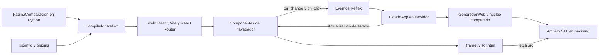
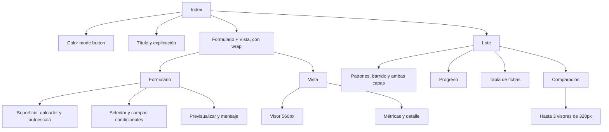
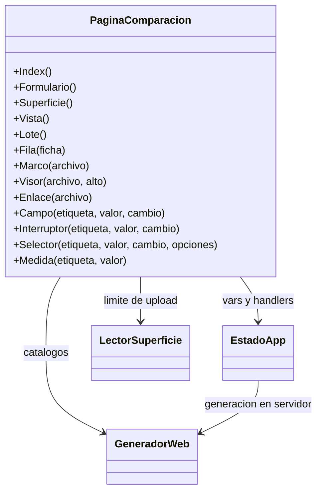

# Arquitectura del frontend Reflex

## Fuente y ejecución

[`web/PaginaComparacion.py`](../../web/PaginaComparacion.py) compone la interfaz con `rx.*`. [`web/GenerateModelsApp.py`](../../web/GenerateModelsApp.py) la registra en `rx.App`; [`rxconfig.py`](../../rxconfig.py) selecciona plugins y tema. Reflex convierte ese árbol a React; el navegador no ejecuta `Model3DForPrinting` ni NumPy.

Las referencias `EstadoApp.pattern`, `EstadoApp.resultados`, etc. dentro de los componentes son expresiones reactivas. `rx.cond` decide contenido a partir del estado y `rx.foreach` genera repetidos. Los eventos `on_change`/`on_click` enlazan con métodos Python del servidor. Los arrays grandes quedan en el backend; React recibe textos, estados y nombres de archivos. La arquitectura del framework se verifica en la [documentación oficial](https://reflex.dev/docs/advanced-onboarding/how-reflex-works/).

No hay un frontend separado escrito a mano en React ni un API client propio de generación. Sí hay JavaScript deliberado en `assets/visor.html` y una expresión JS en `PaginaComparacion.Enlace`. Lo generado bajo `.web/` se reemplaza al compilar: modificar las fuentes Python/HTML para cambios duraderos.

## Árbol de componentes

## Clases y dependencias UML

## Estilos y dependencias

Tema Radix: indigo, gris slate, radio medium; Tailwind V4 y sitemap como plugins. Componentes `rx.card`, stacks, tablas, inputs y botones declaran sus estilos/anchos en Python. Página centrada con máximo 1200px y padding 6; formulario máximo 420px; vista flexible mínimo 320px; comparación mínimo 260px por marco. El wrap hace que bloques salten de línea; no hay un sistema de breakpoints propio.

`reflex.lock/package.json` fija React/ReactDOM 19.2.8, React Router 8.4.0, Radix Themes 3.3.0, Vite 8.2.2 y Tailwind 4.3.0, entre otras dependencias. Son versiones observadas en ese lock, no recomendaciones de actualización. El visor usa Three.js 0.169.0 desde CDN y no comparte el tema de Reflex: su fondo es claro aunque se cambie color mode.

## Fronteras y riesgos actuales

Editar campos no reconstruye, cargar un archivo requiere botón y descargar no ejecuta la validación Blender. Durante generación se bloquean botones principales con `ocupado`; algunos controles siguen editables, pero la generación ya tomó su instantánea. No hay cancelar, guardar proyecto, historial persistente ni sincronización de cámaras de comparación.

`Enlace` usa `Var(_js_expr=..., _var_type=str, _var_data=...)` y `_get_all_var_data`, detalles internos de Reflex sensibles a migraciones. Cambiar la versión del framework requiere comprobar esa composición, upload, vars y background events, no solo que el paquete se importe.
