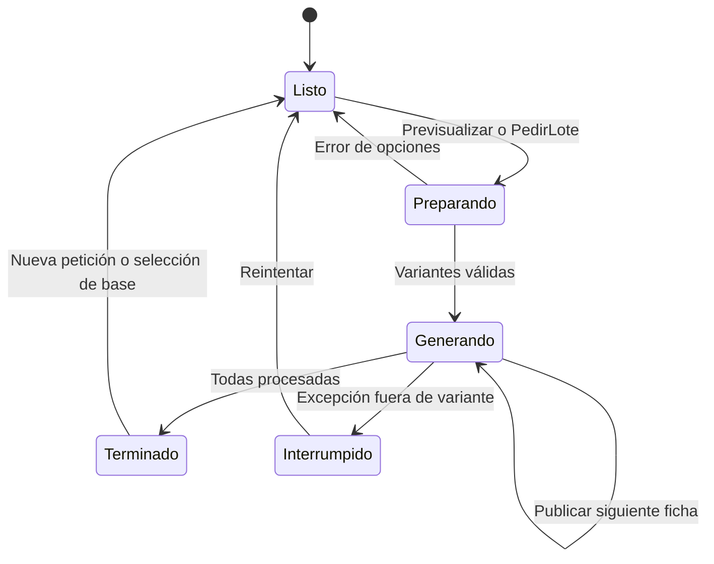

# Componentes, archivos y flujos de interfaz

## Catálogo de archivos

| Archivo/carpeta | Función |
|---|---|
| [`web/PaginaComparacion.py`](../../web/PaginaComparacion.py) | Todos los componentes visuales; `ETIQUETAS_EJE` agrega opción sin barrido a `EJES` |
| [`web/PaginaHistorial.py`](../../web/PaginaHistorial.py) | Página `/historial`: filtros, tabla paginada, acciones por versión y tarjetas de comparación |
| [`web/Sesion.py`](../../web/Sesion.py) | Barra común: navegación, nombre y botón Iniciar/Cerrar sesión |
| [`web/GenerateModelsApp.py`](../../web/GenerateModelsApp.py) | Páginas `/` e `/historial`, títulos y `on_load` |
| [`web/EstadoApp.py`](../../web/EstadoApp.py) | Estado/handlers de `/`; se ejecutan en backend |
| [`web/EstadoHistorial.py`](../../web/EstadoHistorial.py) | Estado/handlers de `/historial` |
| [`web/GeneradorWeb.py`](../../web/GeneradorWeb.py) | Catálogos compartidos y fichas para mostrar; no renderiza |
| [`web/LectorSuperficie.py`](../../web/LectorSuperficie.py) | Límite de subida usado por cliente y lector real servidor |
| [`web/__init__.py`](../../web/__init__.py) | Marcador de paquete |
| [`rxconfig.py`](../../rxconfig.py) | Plugins de compilación y apariencia |
| [`assets/visor.html`](../../assets/visor.html) | Documento independiente Three.js dentro de iframe |
| [`assets/favicon.ico`](../../assets/favicon.ico) | Icono del sitio |
| [`assets/superficie_interior_mm.npz`](../../assets/superficie_interior_mm.npz) | Datos de ejemplo usados por backend; no componente visual |
| `reflex.lock/package.json`, `reflex.lock/bun.lock` | Dependencias JavaScript reproducibles |
| `.web/` | Compilación, dependencias instaladas y archivos públicos generados |

El [inventario global](../Agents/INVENTARIO.md) explica cada archivo auxiliar y los artefactos de `.web/`. [SIMBOLOS.md](SIMBOLOS.md) permite localizar todos los métodos.

## Componentes y bindings

| Método | Composición / conexiones |
|---|---|
| `Index` | Barra de sesión, título, explicación, cambio de tema, Formulario/Vista y Lote |
| `Formulario` | Parámetros → `EstadoApp.<campo>`; `on_change=EstadoApp.set_<campo>`; Previsualizar → `EstadoApp.Previsualizar` |
| `Superficie` | `rx.upload` con ID `superficie-entrada`; selección local visible con badges; botón carga con `rx.upload_files`; botón incluida; avisos y metadatos |
| `Vista` | Si `archivo` no vacío: iframe 560px, detalle, volumen/peso/precio, texto de alcance; si vacío: placeholder |
| `Lote` | Switches de patrones, selector de eje, rango y ambas capas; `PedirLote`, progreso `porcentaje`, tabla `resultados` y comparación `vistas` |
| `Fila` | Columnas de una ficha; Ver, Comparar y STL por ID; botones desactivados si `archivo==''` |
| `Marco` | Wrapper flexible del visor de comparación, alto 320px |
| `Visor` | iframe con title y URL generada por Enlace |
| `Enlace` | `object_url` del STL → expresión JS `/visor.html?src=${encodeURIComponent(url)}` |
| `Campo` | Etiqueta y `rx.input(type='number')` controlado por cadena |
| `Interruptor` | Switch booleano con callback y texto |
| `Selector` | Opciones `(codigo, etiqueta)` → `rx.select` controlado |
| `Medida` | Etiqueta pequeña y valor destacado |

### `/historial` (`PaginaHistorial`)

| Método | Composición / conexiones |
|---|---|
| `Index` | Barra de sesión, título, explicación, Filtros, aviso `mensaje`, Tabla y Comparacion |
| `Filtros` | Selectores Patrón (200px) y Estado (160px), fechas Desde/Hasta y botón Filtrar → `EstadoHistorial.Cargar` |
| `Fecha` | Etiqueta y `rx.input(type='date')` controlado |
| `Tabla` | Columnas Versión, Fecha, Patrón, Parámetros, Estado, Volumen, Peso, Precio y acciones; Anterior/Siguiente con número de página |
| `Fila` | Comparar/Quitar → `Seleccionar`; Restaurar; Reintentar; STL → `Descargar` (desactivado sin URL); aviso rojo si el archivo falta |
| `Comparacion` | Si hay selección, tarjetas lado a lado |
| `Tarjeta` | Versión, patrón, métricas, diferencias de parámetros respecto de la primera elegida y visor de 320px |

### Barra de sesión (`Sesion`)

| Método | Composición |
|---|---|
| `Barra` | Enlaces Comparar e Historial, nombre y botón de sesión según `autenticado` |
| `Boton` | `rx.button(as_child=True)` sobre un ancla con `reloadDocument` |
| `Ruta` | `api_url` de la configuración Reflex + ruta `/auth/*` |

## Reglas de visibilidad

| Condición | Resultado |
|---|---|
| `pattern=='SOLID'` | Muestra espesor macizo; oculta celda, nervadura, capa, giro, marco, banda y paso |
| Patrón distinto de SOLID | Muestra parámetros de retícula y paso |
| `liner=True` en retícula | Muestra espesor capa, transición y espesor nominal total |
| `liner=False` | Texto de rejilla abierta; altura es espesor total |
| `pattern=='VORONOI'` | Muestra semilla |
| `eje!='ninguno'` | Muestra Desde/Hasta/Cada |
| `total>0` | Muestra progreso |
| `vistas.length()>0` | Muestra comparación |
| `ocupado=True` | Previsualizar y Generar lote cargando/desactivados; carga/incluida también desactivadas |
| `subiendo_superficie=True` | Carga/incluida desactivadas; no constituye por sí solo un bloqueo de los botones de generación |

La web muestra posición de banda aunque su ancho sea cero; Blender la oculta en ese caso. La web informa `repair`/`resolution_mm` como texto, sin control editable; no aplica voxel. Todos los campos numéricos deben seguir siendo válidos aunque estén ocultos.

## Flujo de carga y generación

```mermaid
sequenceDiagram
  actor U as Usuario
  participant P as PaginaComparacion
  participant E as EstadoApp
  participant G as GeneradorWeb / ServicioImports
  participant L as ServicioLotes
  participant T as Trabajador
  U->>P: Elegir STL / NPZ
  P-->>U: Nombre seleccionado, aún no cargado
  U->>P: Cargar archivo
  P->>E: CargarSuperficie(upload_files)
  E->>G: GuardarSuperficie en thread (usuario de la cookie)
  alt Entrada válida
    G-->>E: Import ready; original y NPZ en el bucket
    E-->>P: Base nueva, vaciar resultados/vistas
  else Entrada inválida
    E-->>P: Error, conservar base previa
  end
  U->>P: Previsualizar
  P->>E: Previsualizar → Generar
  E->>L: Solicitar lote (request_id)
  loop Cada segundo
    E->>L: Progreso
    L-->>E: Ítems terminados
    E-->>P: Mensaje, porcentaje y fichas
  end
  T-->>L: Resultado confirmado, STL publicado
  P-->>U: iframe carga la object_url
```

Sin sesión, cada acción que toca datos muestra `Inicie sesión para continuar.`. Al recargar `/`, `CargarPredeterminados` vuelve a publicar el último lote del usuario y, si sigue abierto, retoma el seguimiento.

## Flujo de historial

1. `on_load` → `EstadoHistorial.Cargar`: primera página de 25 versiones.
2. Cambiar filtros y pulsar Filtrar: recarga desde la página 1 con cursor nuevo.
3. Comparar en 2–3 filas: tarjetas con visor y lista de parámetros que difieren; la cuarta muestra `Compare hasta 3 versiones a la vez.`
4. Restaurar o Reintentar: encola un lote y redirige a `/`, donde se sigue su progreso.
5. STL: registra la descarga y descarga desde la `object_url`.

## Estado de trabajo



Estos son estados conceptuales, no un enum del código. La implementación usa `ocupado`, `_trabajando`, `hechos`, `total`, `mensaje` y `lote_id`; el estado durable es el del lote en PostgreSQL. Errores individuales se incorporan como filas y pueden coexistir con resultados válidos. Comparar alterna una URL entre hasta tres vistas; Ver reemplaza la principal; descargar usa la `object_url` sin modificar opciones ni regenerar.

## UX y accesibilidad observadas

Interfaz en español, inputs numéricos y componentes Radix; no hay evidencia de una auditoría WCAG completa. `Campo` crea un elemento label visual pero no explicita IDs/`htmlFor` por campo; verificar asociación accesible. El iframe tiene título pero el canvas no ofrece descripción geométrica textual ni controles de cámara por teclado implementados. La tabla permite scroll horizontal y los bloques hacen wrap, pero tamaños mínimos pueden causar desbordes en pantallas estrechas.

La ausencia de mensajes de error por campo, botón de cancelación, descarga de ficha JSON y cámaras sincronizadas describe el estado actual; son oportunidades futuras, no funciones ya desarrolladas.
