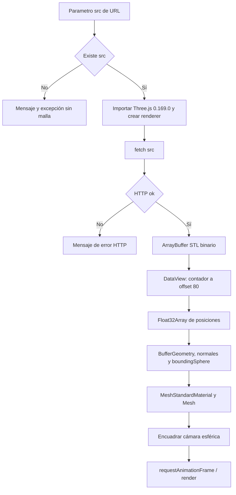

# Visor 3D: código, datos e interacción

Fuente única: [`assets/visor.html`](../../assets/visor.html). Cada vista es un documento HTML autónomo dentro de un iframe, con su propio contexto WebGL, escena, cámara y bucle de dibujo. No comparte cámara ni geometría cargada con otros iframes.

## Carga y representación

`geometria(buffer)` lee uint32 little endian en byte 80 y comienza registros en byte 84. Por triángulo omite 12 bytes de normal, copia nueve float32 de posiciones y omite dos bytes de atributo. Crea geometría **sin índices**, recalcula normales y esfera envolvente. Solo consume el STL **binario generado por el backend**; la aceptación de STL ASCII corresponde al lector de subidas, no a este visor.

No valida explícitamente tamaño, contador máximo o todos los errores de formato. Si fetch/parseo/importación falla fuera de los casos tratados no hay un catch general ni botón de reintento; la consola del iframe es parte del diagnóstico. `src` se codifica al construir la URL pero el HTML acepta la cadena que reciba; esa codificación no es una política de autorización de recursos.

## Escena y cámara

Renderer antialias; pixel ratio máximo 2; fondo `0xeef1f4`. Tres luces: ambiente 0.55, hemisférica 0.45 y direccional 1.15. Material gris `0xd5dbe3`, metalness 0.04, roughness 0.62, `DoubleSide`. La apariencia no expresa material mecánico ni densidad; PETG se calcula en backend.

Perspectiva de 35°. Objetivo en centro de esfera; radio inicial `max(2.4*r,1)`, near=`r/100`, far=`30*r`. `encuadrar()` transforma radio/theta/phi a posición cartesiana y mira al objetivo. No hay grilla milimétrica, cotas ni medidor; comparar dos figuras autoencuadradas no conserva una escala visual común.

| Entrada | Código / resultado |
|---|---|
| Pointer down | Activa arrastre y guarda posición anterior |
| Pointer move mientras arrastra | Delta X/Y ×0.008 cambia theta/phi; phi acotado a `[0.15, pi-0.15]` |
| Pointer up global | Desactiva arrastre |
| Rueda | Multiplica radio por 1.08/0.92, acotado a `[0.4*r,12*r]`; evita scroll por defecto |
| Resize | Actualiza aspect, matriz de proyección y tamaño renderer |
| requestAnimationFrame | Dibuja continuamente aunque no cambie cámara |

No implementa OrbitControls, pan, selección de caras, teclado, exportación de imagen ni resaltado de errores. Tampoco libera explícitamente buffers/materiales ni maneja pérdida de contexto dentro del documento; al quitar iframe el navegador gestiona su ciclo de vida. Hasta tres comparaciones más la principal pueden estar renderizando simultáneamente.

## Relación con el núcleo

El visor representa exactamente las coordenadas STL servidas, con precisión float32 del formato. No genera patrón, no aplica voxel, no calcula volumen/peso/precio y no valida malla. Ver una superficie sin agujeros visuales no prueba `ok`. Los valores de la ficha provienen de la geometría del núcleo, no de una medición WebGL.

La dependencia CDN fija una versión; conectividad y WebGL son requisitos de visualización. El backend puede haber generado correctamente aunque el visor no pueda descargar Three.js. Para un modo offline futuro habría que servir esa dependencia localmente y documentar el cambio; hoy no está implementado.
