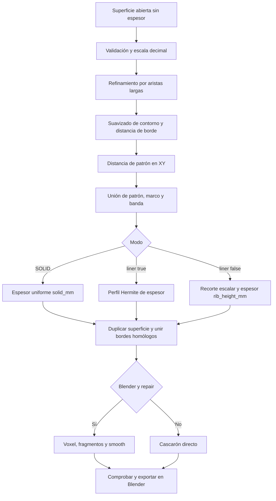

# Algoritmos de generación y comprobación

## 1. Modelo matemático y recorrido

Entrada: superficie triangular abierta con posiciones `p_i`, normales unitarias `n_i` y distancia geodésica al contorno `b_i`. El generador construye un campo escalar sobre esa superficie y decide dónde conservar material y qué espesor aplicar. No reconstruye una anatomía a partir de una fotografía ni de un volumen médico; no usa aprendizaje automático ni un optimizador mecánico.



La web omite C para `SOLID`, entrega métricas/STL directamente y no ejecuta O. El diagrama representa el flujo Blender y el núcleo común.

## 2. Validación, normales y distancia geodésica

Fuente: [`AnalizadorMalla`](../../GenerateModelsApp/Malla.py).

Cada triángulo aporta tres aristas dirigidas. Al ordenar sus extremos se cuentan incidencias: una significa contorno, dos interior y más de dos es no manifold. Si no hay contorno se rechaza como sólido cerrado. Repetir una arista dirigida indica orientación inconsistente. Se detectan triángulos duplicados ordenando sus índices; se verifica área, finitud, índices y ausencia de vértices sueltos. Cada vértice del contorno debe tener grado dos de contorno. Un recorrido de adyacencia exige una sola componente.

Normal por vértice: sumar `cross(p_b-p_a, p_c-p_a)` de caras incidentes y normalizar. El producto cruzado pondera por área. Al refinar se promedian normales vecinas durante 20 iteraciones: mitad normal actual y mitad media de vecinos, renormalizando. Esto suaviza la dirección de desplazamiento sin mover los puntos interiores.

Distancia `b_i`: **Dijkstra multifuente** con todos los vértices de contorno a distancia cero, pesos igual a longitud de arista y cola de prioridad `heapq`. Es una aproximación geodésica discreta por aristas, no un solver continuo sobre triángulos. Su etapa de caminos tiene complejidad aproximada `O((V+E) log V)` y memoria `O(V+E)`; la extracción de aristas con `np.unique` añade ordenación.

## 3. Interpretación de unidades y refinamiento

Fuente: [`EscalaMalla`](../../GenerateModelsApp/EscalaMalla.py), [`RefinadorMalla`](../../GenerateModelsApp/RefinadorMalla.py).

La escala no procede de metadatos STL. Se mide `max(ptp(p, axis=0))` y se buscan factores `10^k`, `k ∈ [-6,6]`, que la dejen entre 20 y 1000 mm. Se prioriza la menor corrección decimal (en empate, exponente positivo). Si ya está dentro del rango se prefiere 1, salvo que el alcance del paso por rondas requiera otra escala plausible. Es una heurística; una pieza pequeña real puede interpretarse como un error de unidades. Desactivar autoescala aplica 1 y conserva la sugerencia.

`Aplicar` filtra factores alcanzables en como máximo 16 mitades y puede reintentar factores menores que sigan dentro del rango si ocurre un error específico de paso. `Presupuesto` estima crecimiento por cuatro, pero solo informa: alcanzar el límite de vértices **no encoge** automáticamente la pieza. `Resolver` es el diagnóstico simple sin ejecutar refinamiento.

Paso efectivo:

```text
SOLID: h = surface_step_mm
Otros: h = min(surface_step_mm, rib_width_mm/3, cell_mm/6)
```

Se extraen aristas únicas y se marcan las de longitud `>1.001*h`. Se crea un punto medio único por arista compartida y se interpolan/normalizan sus normales. Cada triángulo se divide según tenga 0, 1, 2 o 3 aristas marcadas; al compartir índices de punto medio se evitan grietas por subdivisión independiente. La superficie conserva su abertura topológica.

Límites: 16 rondas y presupuesto de 500 000 vértices para añadir nuevos puntos. Si la próxima ronda excede ese presupuesto, se detiene y devuelve una malla que puede no alcanzar `h`. No es una garantía de que toda entrada ya tenga menos de 500 000 vértices, ni de que el cascarón final permanezca bajo ese número. Si agota rondas sin alcanzar paso y sin detenerse por presupuesto, lanza error. El usuario debe revisar el detalle logrado.

## 4. Suavizado del contorno exterior

Fuente: [`SuavizadoBorde`](../../GenerateModelsApp/SuavizadoBorde.py).

Se recorren aristas de contorno en bucles de al menos ocho vértices. Cada bucle se remuestrea uniformemente por longitud de arco, se transforma con `rfft` y recibe un filtro pasabajos: empieza la transición en `0.5/longitud_mm` y anula desde `1/longitud_mm`, usando transición cúbica. Se conservan los modos 0, 1 y 2 para no borrar la forma global. Después se aplica `irfft` y se interpola a la parametrización original.

La longitud de corte predeterminada es 8 mm y el desplazamiento máximo 3 mm. Se comprueba que no invierta ni degenere caras; los desplazamientos responsables se reducen a la mitad hasta 12 intentos y se anulan localmente si siguen fallando. Solo se mueven vértices de borde. Las normales del borde se filtran si conservan acuerdo de signo. Si hubo desplazamiento se recalcula `b_i` para que el marco siga el nuevo contorno.

Consecuencia: preservar la base original no implica que la copia de generación conserve exactamente sus coordenadas de borde. La mejora de dientes puede modificar esquinas y contornos dentro de esos límites. Coste espectral por bucle de longitud `L`: aproximadamente `O(L log L)`, más comprobaciones de caras.

## 5. Proyección y algoritmos de patrón

Fuente: [`Patron`](../../GenerateModelsApp/constants/Paterns.py). Se rota `p[:, :2]` con la matriz del código. La distancia `d_i` se mide en **XY**, en mm de esa proyección. No se desenrolla la superficie ni se mantiene ancho geodésico uniforme: paredes casi verticales y zonas superpuestas en XY pueden repetir/comprimir el patrón.

| Código | Cálculo | Consecuencia |
|---|---|---|
| `SQUARE` | `min(abs((uv+c/2) mod c - c/2))` por punto | Distancia al eje más cercano de retícula ortogonal |
| `DIAMOND` | Misma retícula después de rotación adicional 45° | Cuadrícula girada; no un generador independiente de rombos |
| `HEX` | Semillas en filas alternadas, separación X `c`, Y `c*sqrt(3)/2`, sin jitter | Bisectrices Voronoi de retícula triangular producen celdas hexagonales |
| `VORONOI` | Misma retícula con desplazamiento uniforme ±`0.28*c` por eje, RNG `default_rng(seed)` | Variación orgánica reproducible para igual dominio y parámetros |
| `SOLID` | Vector cero; espesor uniforme en Modeling | No produce celdas |

Para semillas se cubre el rectángulo de puntos más margen `3*c`. Por punto se busca semilla más próxima `s_0` y se calcula distancia a cada bisectriz:

```text
d_j(p) = (||p-s_j||² - ||p-s_0||²) / (2 ||s_j-s_0||)
d(p) = min_j d_j(p), excluyendo s_0
```

No basta usar diferencia de distancias entre las dos semillas más próximas: el código evalúa las bisectrices candidatas. Ordena puntos por X y trabaja en lotes de 384. Filtra semillas por caja local más margen, y vuelve a todas las semillas en puntos donde `radio + 2*d >= margen`, porque no se demuestra la cota de exclusión. Esta optimización conserva la respuesta del conjunto global, ver prueba de superficie extensa.

Coste peor de evaluación: `O(P*S)` con `P` puntos y `S` semillas; la memoria temporal se acota por lotes, aunque puede seguir crecer con muchas semillas. Reducir `cell_mm` aumenta tanto el número de celdas como el trabajo. La semilla no afecta HEX. Igual semilla no garantiza idéntico dibujo al cambiar el bounding box, porque cambia la retícula de partida.

## 6. Campo de material: patrón, marco y banda

Fuente: `Model3DForPrinting.ConstruirGeometria` en [`Modeling.py`](../../GenerateModelsApp/Modeling.py).

```text
s_i = rib_width_mm/2 - d_i
si border_mm > 0:
    s_i = max(s_i, border_mm - b_i)
si reinforce_width_mm > 0:
    s_i = max(s_i, reinforce_width_mm/2 - abs(p_i.y - reinforce_y_mm))
```

El máximo representa unión de zonas de nervadura, marco y refuerzo. El marco sigue todos los contornos existentes; no conecta labios opuestos. La banda es una franja sobre el Y **original/local** de la superficie y no rota con el patrón. Solo afecta caras que ya existen.

Con `SOLID`, el campo no altera el espesor: se usa `solid_mm`. Con `liner=True`, no se eliminan caras:

```text
w = max(0.02, rounding_mm)
u_i = clamp(s_i/w + 0.5, 0, 1)
H(u) = u²(3-2u)
t_i = skin_mm + rib_height_mm * H(u_i)
```

En celdas el espesor nominal es `skin_mm`; en nervaduras plenamente desarrolladas, `skin_mm+rib_height_mm`. `rounding_mm` controla el ancho de transición del campo, **no un radio de bevel**. Sin capa, se conserva `s>=0` y el espesor restante es constante `rib_height_mm`.

## 7. Recorte triangular sin capa

Fuente: `Cascaron.Recortar` en [`Cascaron.py`](../../GenerateModelsApp/Cascaron.py).

Para cada triángulo se conserva la parte de campo positivo mediante recorte lineal por aristas. En un cruce:

```text
alpha = s_a / (s_a-s_b)
p = (1-alpha)*p_a + alpha*p_b
n = normalize((1-alpha)*n_a + alpha*n_b)
```

Se reutilizan vértices originales y cruces mediante diccionarios por índice y arista no dirigida. Se triangula el polígono recortado en abanico y se compactan índices usados. Para evitar regiones conectadas solo por un vértice, valores con `abs(s)<0.005 mm` se convierten en margen positivo. Esto cambia ligeramente el umbral ideal. Si no queda ninguna cara, lanza `SuperficieEliminadaPorPatron`.

El campo se interpola sobre los triángulos existentes, de modo que la precisión de los huecos depende del refinamiento. Sin una capa continua, una retícula puede fragmentarse según la forma; el generador no garantiza conectividad final por mera construcción del campo.

## 8. Engrosado y aberturas

`Cascaron.Engrosar` duplica posiciones con `q_i=p_i+n_i*t_i`. Añade una piel con el orden original y otra con orden inverso; por cada arista libre `(a,b)` añade el cuadrilátero `(b,a,a+N,b+N)`. **Cada borde se une exclusivamente con su copia**. No triangula el espacio interior de un canal ni crea tapas anatómicas.

`flip_normals` cambia `n` por `-n` y revierte caras antes del proceso, conservando orientación consistente. `Cerrar` es un alias de `Engrosar`. Para `N` vértices quedan `2N` posiciones, dos copias de las caras y un muro por arista libre. Curvatura fuerte y desplazamientos grandes pueden producir autointersecciones; volumen cerrado topológicamente no equivale a resultado geométrico válido.

## 9. Reconstrucción y reparación de Blender

No confundir las dos operaciones:

| Operación | Algoritmo | Mutación |
|---|---|---|
| Arreglar base | BMesh: hornear escala, `remove_doubles` a 1e-6 mm, borrar degeneradas/duplicadas/sueltos, conservar mayor componente por caras, triangular y recalcular normales | Escribe la base tras validar; no extrae piel de un sólido ni cierra contornos |
| `repair=True` | Modificador Blender `REMESH` modo `VOXEL`, adaptivity 0, análisis de componentes y modificador `SMOOTH` | Cambia el resultado y puede cerrar huecos estrechos |

Espesor mínimo `m`: macizo → `solid_mm`; con capa → `skin_mm`; rejilla abierta → `min(rib_height_mm,rib_width_mm)`. Voxel efectivo `v=min(resolution_mm,m/3)`. Si `v<0.15 mm`, se aborta antes de crear la nueva malla. Elegir una resolución grande no evita el rechazo si `m/3` es demasiado pequeño.

Tras voxel se agrupan vértices por conectividad. Se conserva el mayor grupo; suma de vértices en otros grupos debe ser ≤`max(50,0.005*total)`. Si excede, error `GeometriaFragmentada`; si no, se retiran residuos y se aplica SMOOTH factor 0.3 durante dos iteraciones. El voxel concreto lo implementa Blender; el repositorio configura el modificador, no contiene un solver voxel propio.

## 10. Validación, exportación y métricas

`ValidadorMalla.Comprobar` triangula una copia BMesh, cuenta aristas abiertas/no manifold, caras con área <1e-8, componentes y cruces. Construye BVH y revisa pares solapados; excluye pares que compartan vértices y prueba intersección segmento-triángulo con parámetro interior `(1e-6,1-1e-6)`. No cubre todos los solapes coplanares ni garantiza ajuste/resistencia. Con `intersections=False` se omiten cruces y el informe refleja cero; no interpretar ese informe como examen completo.

`ok` requiere cero defectos contados y una sola componente. Exportar vuelve a comprobar; escribe STL binario seleccionado con `global_scale=1`, `use_scene_unit=False`, modificadores aplicados, y `*.stl.json` con parámetros/informe/unidades. No hay atomicidad conjunta: si falla el JSON el STL puede existir ya.

Volumen del cascarón: triangular polígonos y calcular `abs(sum(dot(a,cross(b,c))))/6`. Una malla autointersectada puede dar un número y seguir ser inválida. Peso y precio del núcleo se calculan antes de voxel. Las pruebas geométricas son probetas, no validación clínica.
