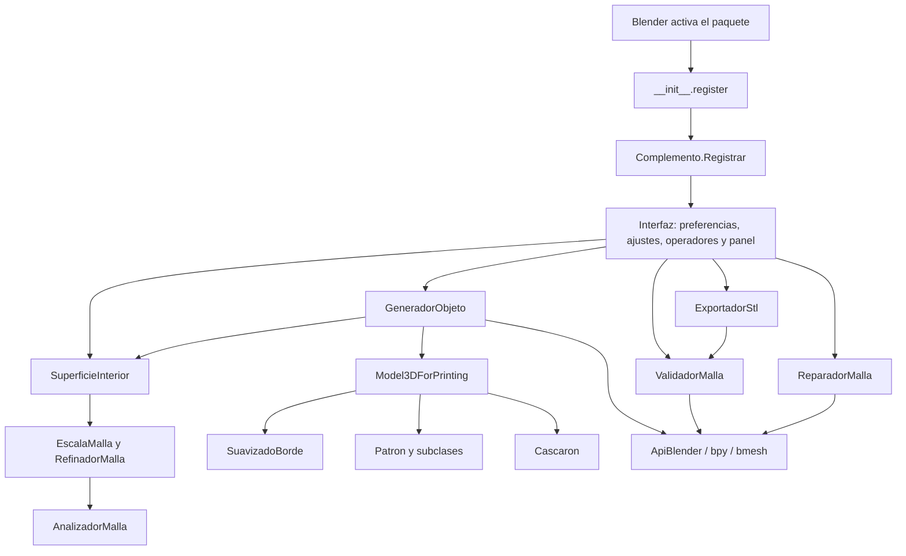
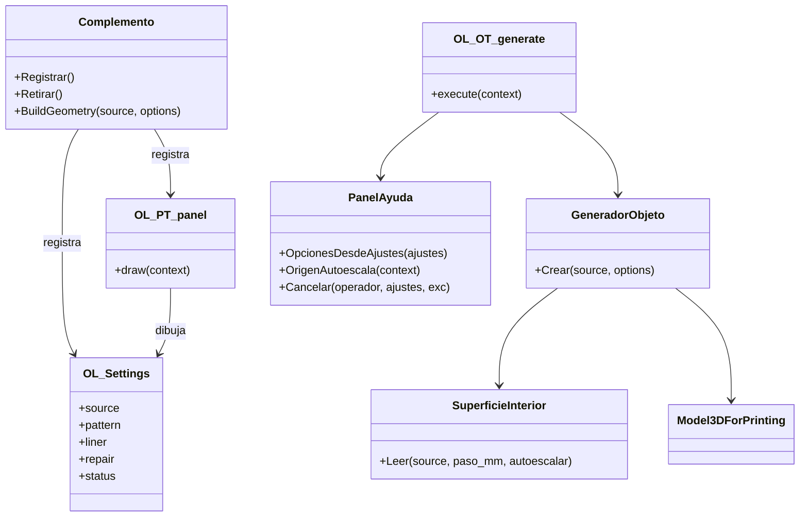

# Arquitectura del complemento

## Capas y dependencias

El paquete [`GenerateModelsApp/`](../../GenerateModelsApp/__init__.py) contiene un núcleo Python/NumPy y adaptadores de Blender. `__init__.py` declara `bl_info` y difiere las importaciones de registro: importar el paquete o el núcleo no carga `bpy`. `ApiBlender.py` concentra las importaciones `bpy`, `bmesh`, propiedades y utilidades mathutils; fuera de Blender produce `EntornoBlenderRequerido`.



`Complemento.BuildGeometry` prepara y construye arrays, sin crear el objeto resultado ni aplicar voxel. `GeneradorObjeto.Crear` agrega la escritura en escena, visibilidad, metadatos y reconstrucción opcional. Ambos calculan el paso con `RefinadorMalla.PasoPatron`.

## Registro y ciclo de vida

`Complemento.Registrar` primero retira un registro anterior; registra `CLASSES` en orden y crea `bpy.types.Scene.ortesislab` como `PointerProperty(OL_Settings)`. Guarda la tupla de clases en `bpy.app.driver_namespace['_ortesislab_classes']`. Si falla a mitad del registro, intenta desregistrar lo ya registrado. `Retirar` elimina la propiedad y recorre las clases en orden inverso.

Las ocho clases registradas son preferencias, ajustes, usar superficie, arreglar base, generar, validar, exportar y panel. Los nombres `register`, `unregister`, `draw`, `execute`, `invoke` y `poll` se mantienen porque Blender los busca por contrato. Los controles no tienen actualización automática de geometría: hay que ejecutar Generar.



## Secuencia al generar

```mermaid
sequenceDiagram
  actor Usuario
  participant O as OL_OT_generate
  participant S as SuperficieInterior
  participant K as Model3DForPrinting
  participant G as GeneradorObjeto
  participant B as Escena Blender
  Usuario->>O: Generar / actualizar
  O->>O: Elegir source o activo; copiar ajustes
  O->>G: Crear(source, opciones, autoescalar)
  G->>G: ValidarOpciones y PasoPatron
  G->>S: Leer y refinar copia
  S-->>G: Puntos, triángulos, normales y borde
  G->>K: Construir
  K-->>G: Cascarón, configuración y conteos
  G->>G: Verificar resolución voxel si repair
  G->>B: Crear o reemplazar malla de OL_Ortesis
  G->>B: Copiar matrix_world, guardar metadatos y ocultar base
  opt repair activado
    G->>B: Aplicar REMESH VOXEL
    G->>G: Revisar fragmentos y retirar residuos pequeños
    G->>B: Aplicar SMOOTH
  end
  G-->>O: Objeto resultado
  O-->>Usuario: Estado y aviso de escala
```

## Escena, coordenadas y mutaciones

- La base es el objeto seleccionado en `source`; si está vacío, se toma el activo. Se rechaza el propio resultado, Edit Mode, modificadores pendientes y escala distinta de uno dentro de tolerancia `1e-6`.
- Se leen coordenadas **locales** y se triangula la representación de lectura. Normales actuales se recalculan por área; el atributo antiguo `ol_offset_normal` no controla Generar.
- Al generar no se alteran las coordenadas base, aunque se oculta el objeto (`hide_set`, `hide_render`). El resultado copia `matrix_world`, para mantener su ubicación/orientación.
- `OL_Ortesis` es un único nombre resultado en la escena: generar otra base sustituye su geometría. No existe un catálogo de versiones de escena.
- Al reemplazar, se elimina el datablock de malla previo solo si no tiene usuarios. Se selecciona el resultado y se vuelve activo.
- Arreglar base sí modifica la entrada: hornea escala, limpia y guarda solo después de validar una copia BMesh. Si el datablock es compartido, lo copia antes de escribir.

Generar no es una transacción completa: fallos antes de escribir conservan el resultado anterior; fallos después de reemplazar/aplicar voxel pueden dejar un resultado parcial. Los operadores de generación y reparación tienen `UNDO`, pero el código no implementa rollback propio de toda la operación.

## Unión con la aplicación

La integración está en `Model3DForPrinting`, los contratos de arrays y los JSON compartidos. La web entrega STL desde Python; Blender entrega STL mediante su operador nativo después de validar. El macizo web omite refinamiento y Blender lo aplica también en macizo. Normales importadas por NPZ pueden diferir de las recalculadas desde Blender/STL. Comparar resultados exige controlar superficie, orientación, escala, paso, configuración y ausencia de voxel.
